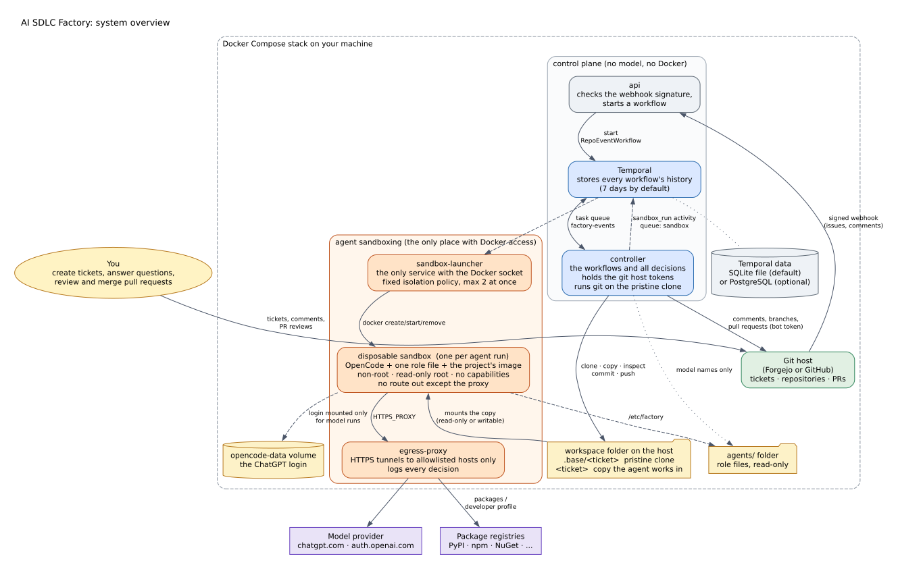

# Dev Foundry

An AI development factory built around a git host (Forgejo or GitHub), Temporal and disposable agent containers. You label a ticket on the host; role agents analyse it, write the code (or the fix, or the
incident advice) in isolated sandboxes, and the factory hands you a **reviewed pull request**. A person reviews and merges; the factory never merges.

## What it does

| Label the ticket | You get |
| --- | --- |
| `feature` | analysis, a check that it is not already built, an optional design review, the implementation, the project's own checks, code/security/UX review and an acceptance check, then a pull request |
| `bug` | a pull request with a fix **proven by a test that failed before and passes after**; the factory runs that proof itself |
| `docs` | a pull request that writes or updates `AGENTS.md`, `README.md` and `docs/` from the code, checked by the reviewers |
| `incident` | an assessment, ranked likely causes (every cited file and commit is verified) and mitigation options, driven by `/option`, `/hotfix` and `/resolved`; a draft postmortem on request. It never touches production |

On top of the labels, people steer with comments on a ticket or pull request (the [commands and labels cheat sheet](docs/commands.md) says what to type where): `/fix` (revise the pull request), `/update` (merge the base branch into it, resolving conflicts), `/review` (have the reviewers read any pull request and post findings), `/ask` (ask a question about the repository on any ticket or pull request; a read-only agent answers from the code), `/retry` (run a ticket again from the last good stage, or `/retry restart` from the beginning), `/qa` (test the running application, with `/qa full` and `/fix qa`), and `/option`, `/hotfix` and `/resolved` on incidents. A [demo "production"](companions/demo/README.md) with Prometheus, Grafana and Loki shows the incident side: an alert opens a ticket by itself and the factory starts on it.

Everything is deterministic where it matters: agents only advise with one validated JSON verdict, and code decides every next step. Each agent runs in a throwaway container with no route to the
internet except an allowlisting proxy. See [Architecture](docs/architecture.md) and [Workflows](docs/workflows.md).

## Quick start

1. [Set up the factory](docs/getting-started.md): configure `infra/.env`, `docker compose up -d --build`, build the sandbox images, create the bot account, sign the agents in. About 30 minutes, once.
2. [Connect a repository](docs/project-setup.md): bot access, a webhook, labels, and a small `.factory/project.json`. About 5 minutes per repository.
3. Create a ticket, add the `feature` label, and watch the comments appear.

## Documentation

Start at the [documentation index](docs/README.md).

| Guide | Covers |
| --- | --- |
| [Getting started](docs/getting-started.md) | Installing and configuring the factory, step by step |
| [Setting up a project](docs/project-setup.md) | Webhook, labels, `.factory/project.json` (required and optional settings), `AGENTS.md` |
| [Workflows](docs/workflows.md) | Routing, every workflow (feature, bug, incident, plan, docs, revisions, updates, QA, reviews, the weekly report), quick mode, `/retry`, statuses, limits (with diagrams) |
| [Architecture](docs/architecture.md) | The parts, trust boundaries, where data lives |
| [Configuration](docs/configuration.md) | Every setting: `.env`, service variables, agents and models |
| [Operations](docs/operations.md) | Watching runs, troubleshooting, cleaning up, backups, security notes |
| [Design and decisions](docs/design.md) | Why it is built this way, and findings from running it |
| [Infrastructure](infra/README.md) | Compose services, local addresses, the bot account |
| [Demo and monitoring](companions/demo/README.md) | A demo production for the weather app with Prometheus, Alertmanager, Grafana and Loki, where alerts open tickets |
| [Agents](agents/README.md) | The role files, permissions and models |
| [OpenCode login](docs/opencode-login.md) | Signing the agents in with a ChatGPT account |

## Repository

- [`infra/`](infra/README.md): Docker Compose and environment settings.
- [`src/`](src/): the code, one folder per service with its own Dockerfile and README, and the library they share; their tests are in [`tests/`](tests/), one folder per service. [`src/api/`](src/api/README.md): webhook intake. [`src/controller/`](src/controller/README.md): workflows, agent prompts and parsers, workspace and git host handling.
  [`src/sandbox-launcher/`](src/sandbox-launcher/README.md): the only service with Docker access. [`src/egress-proxy/`](src/egress-proxy/README.md): the proxy that decides what sandboxes may reach, with its [allowlist](src/egress-proxy/ALLOWLIST.md) (`profiles.json`).
- [`companions/`](companions/): things that run beside the factory, each with its own README, Compose file or Dockerfile and no shared code: [`forgejo/`](companions/forgejo/README.md) (a Forgejo to try the factory on), [`alert-intake/`](companions/alert-intake/README.md) (turns monitoring alerts into tickets) and [`demo/`](companions/demo/README.md) (a demo production with monitoring, and the scripts to set it up, deliver code to it and break it on purpose).
- [`agents/`](agents/README.md): one Markdown file per agent role, plus shared OpenCode settings.
- [`templates/`](templates/README.md): working starter projects (.NET, Python, React, .NET + React) to copy, with every feature switched on.
- [`sandboxes/`](src/sandbox-launcher/README.md#images): Dockerfiles for the images agents run in (`dotnet`, `python`, `node`, and the combined `dotnet-node`, `python-node`, `full`, plus `browser` for end-to-end UI tests).
- [`src/contracts/`](src/contracts/Contracts.cs): the library the services share: wire types, with the git host list, triggers and webhook adapters in `Hosts/`.
- [`tools/`](tools/): `check-docs.py` (the documentation check), `usage-report.py` (token totals from the usage log) and `check-clock.py`.
- [`bitbucket-pipelines.yml`](bitbucket-pipelines.yml): CI running the service tests, a vulnerable-package check, the documentation check and the deployed-pipeline test.

All services are C# on .NET 10; open [dev-foundry.slnx](dev-foundry.slnx) (it holds `src/` and `tests/`) in your IDE. Build settings live in [`Directory.Build.props`](Directory.Build.props) and NuGet versions in
[`Directory.Packages.props`](Directory.Packages.props); change a package version there, not in a project file.
