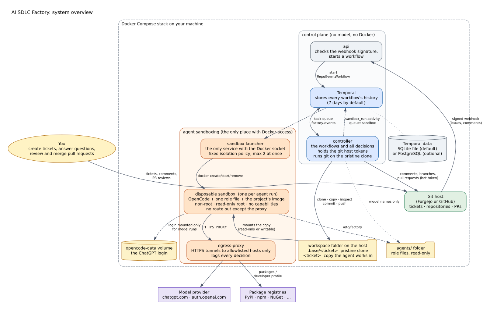

# Documentation

Dev Foundry is an AI development factory: a Forgejo ticket becomes a reviewed pull request (features and bug fixes) or advice (incidents), produced by role agents that run in
disposable, isolated containers. A person reviews and merges; the factory never merges.

## Start here

| I want to... | Read |
| --- | --- |
| **run the factory** for the first time | [Getting started](getting-started.md) |
| **connect a repository** and understand `.factory/project.json` (what is required, what is optional) | [Setting up a project](project-setup.md) |
| start from a **working example project** (.NET, Python, React, or .NET + React) with every feature switched on | [Templates](../templates/README.md) |
| copy a ready-made **`AGENTS.md` and `project.json`** for a .NET or React project | [Examples](examples/README.md) |
| understand **what happens to a ticket or a review**, step by step, with diagrams | [Workflows](workflows.md) |
| understand **how it is built** and why it is safe to run | [Architecture](architecture.md) and [Design and decisions](design.md) |
| look up a **setting**, a port, a default | [Configuration reference](configuration.md) |
| **operate** it: watch runs, troubleshoot, clean up, back up, update | [Operations](operations.md) |
| change an **agent**, its model or its permissions | [Agents](../agents/README.md) |
| sign the agents in with ChatGPT | [OpenCode login](opencode-login.md) |
| run a **demo "production"** with monitoring (Prometheus, Grafana, Loki) where alerts open tickets | [Demo and monitoring](../demo/README.md) |
| know the **limits** of what is built | [Known limitations](operations.md#known-limitations) |

## Guides by component

| Component | Guide |
| --- | --- |
| Compose stack, local addresses, bot account | [Infrastructure](../infra/README.md) |
| Webhook intake | [api](../services/api/README.md) |
| Workflows and workspace handling | [controller](../services/controller/README.md) |
| Starting sandboxes | [sandbox-launcher](../services/sandbox-launcher/README.md) |
| Internet access of the sandboxes | [egress-proxy](../services/egress-proxy/README.md) and the [allowlist](../egress/README.md) |
| Alerts to tickets | [alert-intake](../services/alert-intake/README.md) |
| Demo production and monitoring | [demo](../demo/README.md) |
| Deployed-pipeline test | [integration tests](../tests/integration/README.md) |

## The diagrams

Every picture is a Graphviz source in [`diagrams/`](diagrams/) with a rendered SVG in [`images/`](images/). After editing a source run `sh docs/diagrams/render.sh` (needs only Docker).

| Diagram | Shows |
| --- | --- |
| [architecture](images/architecture.svg) | the parts and how they talk |
| [ticket-routing](images/ticket-routing.svg) | from a Forgejo event to a workflow |
| [feature-workflow](images/feature-workflow.svg) | a feature ticket to a pull request |
| [bug-workflow](images/bug-workflow.svg) | the red-then-green bug fix |
| [pr-revision](images/pr-revision.svg) | a review becomes one new commit on the same branch |
| [pr-update](images/pr-update.svg) | `/update` merges the base branch into a pull request |
| [qa-workflow](images/qa-workflow.svg) | `/qa` tests a finished pull request from the outside |
| [incident-workflow](images/incident-workflow.svg) | advice, commands and the postmortem |
| [agent-run](images/agent-run.svg) | one agent run, from request to verdict |
| [workspace-trust](images/workspace-trust.svg) | the two copies of the checkout |
| [monitoring](images/monitoring.svg) | the demo production, its monitoring and how an alert becomes a ticket |

## Keeping it correct

`python3 tools/check-docs.py` checks links, anchors, diagrams, and that every setting, project key, agent role, result status and label in the code is documented. CI runs it.
When you change behaviour, change the matching page in the same commit.
