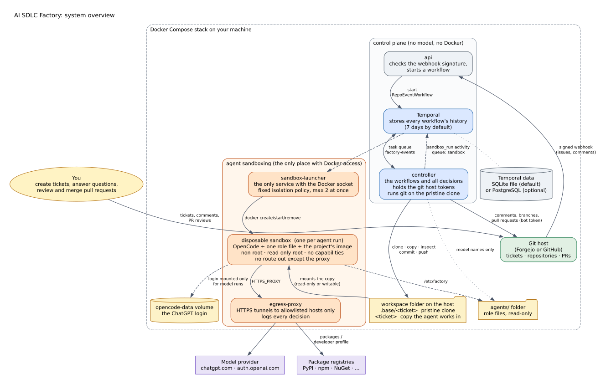
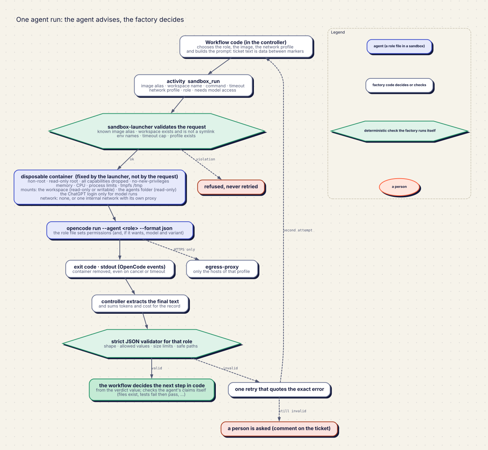
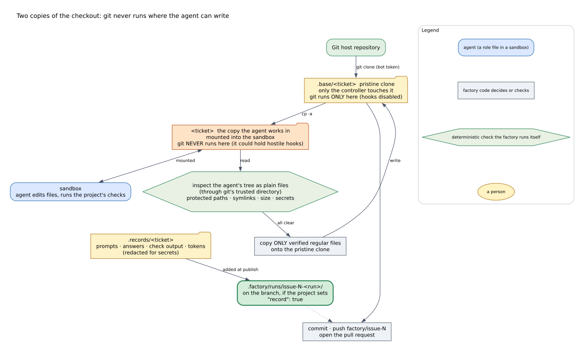

# Architecture

[Documentation index](README.md)

AI SDLC Factory turns tickets on a git host (Forgejo or GitHub) into reviewed pull requests (features and bug fixes) and into advice (incidents), using role
agents that run in disposable containers. This page explains the parts, how they talk to each other, and where the trust
boundaries are. How each kind of ticket is handled is in [Workflows](workflows.md).

## The parts

| Part | What it does | Why it is separate |
| --- | --- | --- |
| **Git host** (Forgejo or GitHub; as many as `FACTORY_HOSTS` lists) | Holds the repositories, tickets, labels and pull requests. People work here. | It is the human interface; the factory needs no other one, and no host is built in: each kind has an adapter. A Forgejo to try it on is a separate project ([`forgejo/`](../deploy/forgejo/README.md)). |
| **api** ([guide](../src/api/README.md)) | Receives signed webhooks from the git hosts, checks the signature, starts a Temporal workflow. | It faces the network (webhooks) but has no git host token, no Docker and no business logic. |
| **Temporal** | Durable workflows: every step, prompt, answer and check output is stored in its history; waits for people cost nothing. | A run can take days (waiting for answers) and survives restarts. |
| **controller** ([guide](../src/controller/README.md)) | Runs the workflows. Decides every next step in code, holds the only git host tokens, runs git, validates what agents answer. Also runs the janitor and starts the weekly report on what repeated. | All decisions live in one reviewed, tested place. |
| **sandbox-launcher** ([guide](../src/sandbox-launcher/README.md)) | The only service with the Docker socket. Starts one disposable container per agent run with a fixed isolation policy. | Docker access is effectively root on the host; it is kept in a small service that has no tokens and takes requests it can validate. |
| **egress-proxy** ([guide](../src/egress-proxy/README.md)) | The only way out of a sandbox: HTTPS tunnels to allowlisted hosts, everything logged. | An agent that is tricked by text must not be able to send code or the login anywhere. |
| **Sandboxes** | One per agent run: OpenCode, one role file, the project's language image. | Disposable and isolated: non-root, read-only root, no capabilities, no route out except the proxy. |
| **Agents folder** ([guide](../agents/README.md)) | One Markdown file per role: permissions, model, prompt. | Roles are reviewed like code and change without a rebuild. |
| **PostgreSQL** | The Temporal databases. | Standard. pgAdmin is a development convenience. |

Docker Compose runs all of it on one machine ([Deployment](../deploy/README.md)). The services are .NET 10 and live under
[`src/`](../src/) (one folder each, with its Dockerfile and README; their tests are in [`tests/`](../tests/)); the wire types they share are in [`src/contracts`](../src/contracts/Contracts.cs).

## How a ticket flows

1. A person creates or labels a ticket on a git host. The host sends a **signed webhook** to the api.
2. The api verifies the signature (HMAC-SHA256 over the exact bytes) and starts `RepoEventWorkflow` in Temporal. How a host signs and words its events is the job of that host's **webhook adapter** (`src/contracts/Hosts/Webhooks.cs`; Forgejo's and GitHub's exist): the api serves one route per configured host (`/webhooks/<name>`), and the workflow reads the delivery through the same adapter into the factory's own `RepoEvent`, which is all the router ever sees. Repeated
   deliveries of the same id are ignored.
3. That workflow is the **router**: with fixed rules it starts the ticket's own workflow (feature, bug, incident, plan or docs), starts
   the workflow a slash command asks for on a ticket or pull request (`/fix`, `/update`, `/qa`, `/review`, `/retry`), signals a
   waiting workflow with a comment, or ignores the event. See [Ticket routing](workflows.md#ticket-routing).
4. The ticket's workflow runs on the **controller**. For every agent step it asks the launcher (through Temporal, queue
   `sandbox`) to run a command in a sandbox. The workflow, not the agent, decides what happens with the answer.
5. Results come back to the ticket as comments, and to the repository as a branch and a pull request created by the controller.
   A person reviews and merges. **The factory never merges.**

Two Temporal task queues connect the pieces: `factory-events` (api to controller) and `sandbox` (controller to launcher).

## What an agent run looks like

The important property: **an agent only advises**. It returns one JSON verdict in a fixed shape; strict code checks the shape,
the allowed values, the size limits and the file paths, and then code decides the next step. Wherever an agent makes a claim that
can be checked (a file exists, a commit exists, a test fails and then passes) the factory checks it itself.

## Trust boundaries

| Boundary | How it is kept |
| --- | --- |
| **Docker access** | Only the launcher has the socket, runs as an unprivileged user, and builds containers from one fixed specification. A request can choose only an image alias from an allowlist, an existing workspace folder, writable or not, a command, a timeout, a few `OPENCODE_`/`FACTORY_` variables, a role label, whether it needs model access and a network profile. |
| **Git host tokens** | Only the controller has them. It reaches git through the environment, never in an argument list or a repository config, and never enters a sandbox. |
| **The OpenCode login** | A Docker volume mounted only into runs that call the model. Lint, build and test runs never see it. |
| **The network** | A sandbox has no route out and no external DNS. It reaches one profile's allowlisted HTTPS hosts through its own proxy address. The allowlist is operator configuration; a repository cannot widen it. |
| **The repository** | `.factory/project.json` is untrusted input. It can choose among options the factory already offers (an image alias, commands that run in the same sandbox as the agent, which reviewers). It cannot add hosts, models, permissions or images. |
| **The agents' files** | An agent works in a copy of the checkout and never in the pristine clone where git runs (below). |
| **Ticket and repository text** | Reaches a model only between markers, clipped, and labelled as data. Model text is made inert (no `@mentions`, no formatting tricks) before it is posted. |

### Why there are two copies of the checkout

An agent can write anything into its workspace, including `.git/hooks` and `.git/config` entries that run commands the next time git
runs there. So git never runs in the agent's copy. The controller clones into `.base/<ticket>`, which no sandbox mounts, copies it to
`<ticket>` for the agent, reads the agent's changes from that tree as plain files, checks them, copies only verified regular files back
onto the pristine clone, and commits and pushes from there. A test plants a hostile hook and config and proves nothing runs.

### What the sandbox cannot protect against

- **Data sent to an allowed host.** The model provider receives whatever is in a prompt, and a package registry accepts requests from anyone. The proxy sees host names, not content.
- **Commands in `.factory/project.json`.** The project's checks run in the sandbox with package access and no model access. A repository owner decides what they do; they get no more reach than the agent has.
- **A person with comment access** on a ticket can steer a run (answer questions, use incident commands) unless the operator restricted who: the git host's repository permissions are the access control by default, and a `commands` rule in `FACTORY_HOSTS` can ask for write or admin access, or name the people (the controller asks the host, keeps the answer briefly, and refuses when it cannot find out).

The [egress guide](../src/egress-proxy/ALLOWLIST.md) describes the network rules in detail; [Operations](operations.md#security-notes) lists the practical checks.

## Where data lives

| Data | Where | Kept |
| --- | --- | --- |
| Tickets, branches, pull requests | the git host | until you delete them |
| Every workflow step: prompts, agent answers, check output | Temporal history | 7 days after a run ends (`TEMPORAL_RETENTION`) |
| Checkouts (pristine clone and agent copy) | `FACTORY_WORKSPACE_ROOT` on the host | removed when the workflow ends; leftovers of runs that were stopped by hand are removed by the [janitor](operations.md#cleaning-up) after a few days |
| The stages a feature or bug run finished (for `/retry`) | `.resume/<run>.json` under `FACTORY_WORKSPACE_ROOT` | until a pull request opens, or the janitor removes it |
| One line per finished run (tokens, rounds, per-agent figures; no ticket text) and the weekly reports | `.usage/usage.jsonl` and `.usage/reports/` under `FACTORY_WORKSPACE_ROOT` | until you move or delete them ([usage log](operations.md#the-usage-log-totals-across-tickets-days-and-repositories)) |
| The run record (prompts, answers, check output, tokens, cost) | `.factory/runs/` in the pull request or work-in-progress branch, if the project sets `"record": true` | with the repository |
| The OpenCode login | Docker volume `opencode-data` | until the volume is removed |
| Egress decisions | `docker compose logs egress-proxy`; every refusal also in the `egress-log` volume (`denied.jsonl`, at most 10 MB), which the controller reads for the weekly report | the console log as long as Docker keeps it; the file until the volume is removed |

## The code

| Folder | Content |
| --- | --- |
| [`src/api`](../src/api) | webhook intake |
| [`src/controller`](../src/controller) | workflows, agent prompts and parsers, workspace and git host handling |
| [`src/sandbox-launcher`](../src/sandbox-launcher) | container policy and the Docker client |
| [`src/egress-proxy`](../src/egress-proxy) | the CONNECT proxy, its allowlist policy and the allowlist itself (`profiles.json`) |
| [`src/contracts`](../src/contracts) | the library the services share: wire types, the git host list, triggers and the webhook adapters of each kind of host |
| [`tests/`](../tests) | the tests of each service, one folder each (the workflow scenarios run on a Temporal dev server) |
| [`alert-intake`](https://github.com/OWNER/ai-sdlc-factory-alert-intake) | a component outside the factory, with its own build and tests: turns monitoring alerts into tickets |
| [`sandboxes/`](../sandboxes) | the images agents run in (`dotnet`, `python`, `node`, and the combined `dotnet-node`, `python-node`, `full`, plus `browser`) and their shared entrypoint |
| [`agents/`](../agents) | role files and shared OpenCode settings |
| [`deploy/`](../deploy) | Docker Compose and environment settings |
| [`templates/`](../templates) | working starter projects and loose examples to copy into a repository |
| [`tools/`](../tools) | the documentation check, the scenario runner, the usage report and the repository onboarding script |

The controller's code layout is in its [guide](../src/controller/README.md#code-layout).
