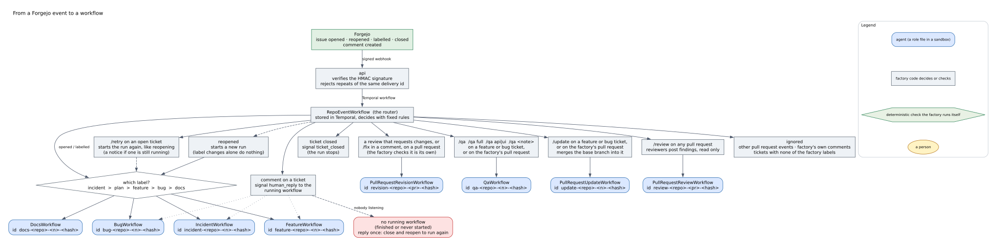
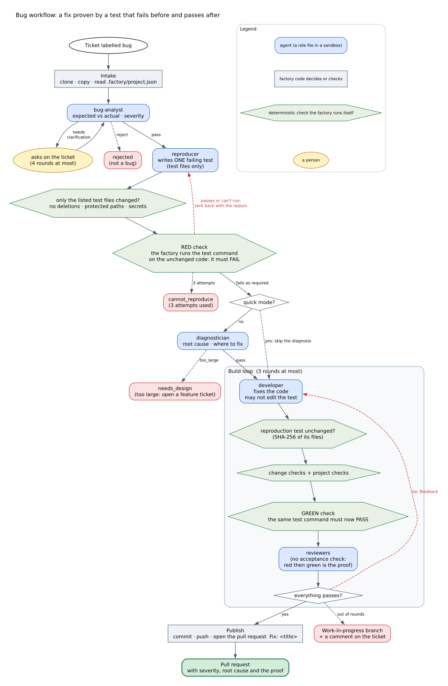
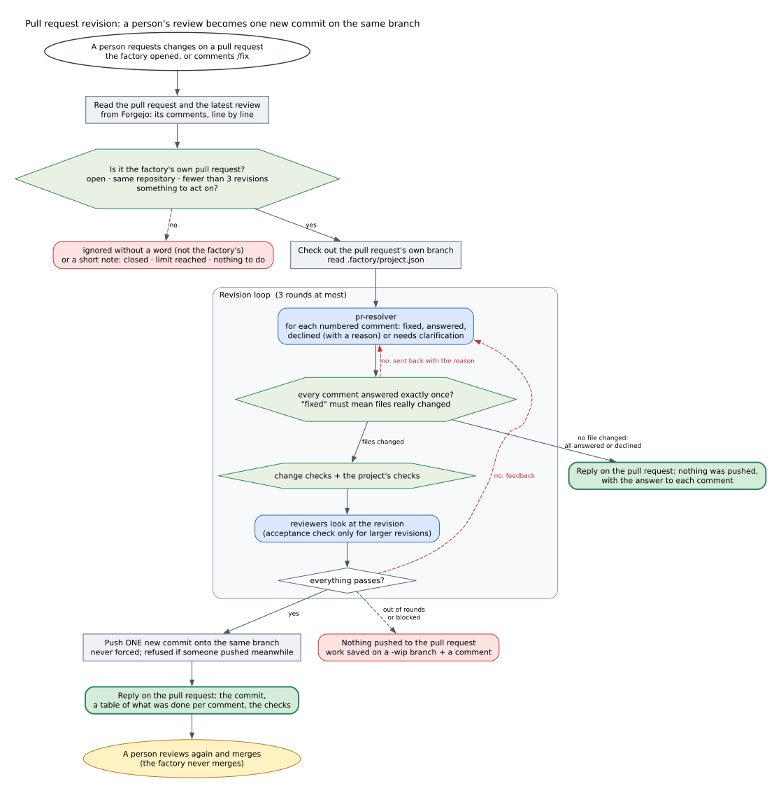
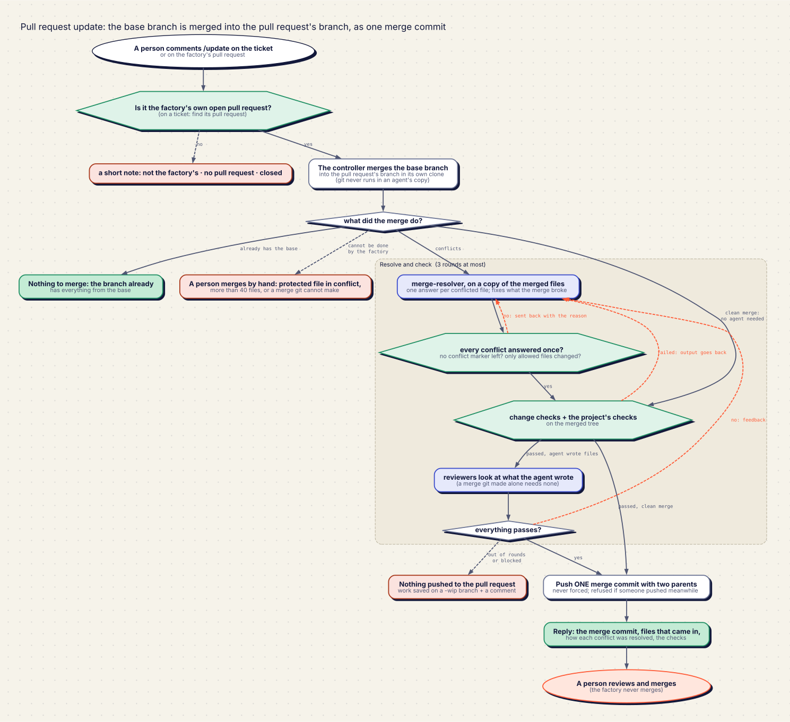
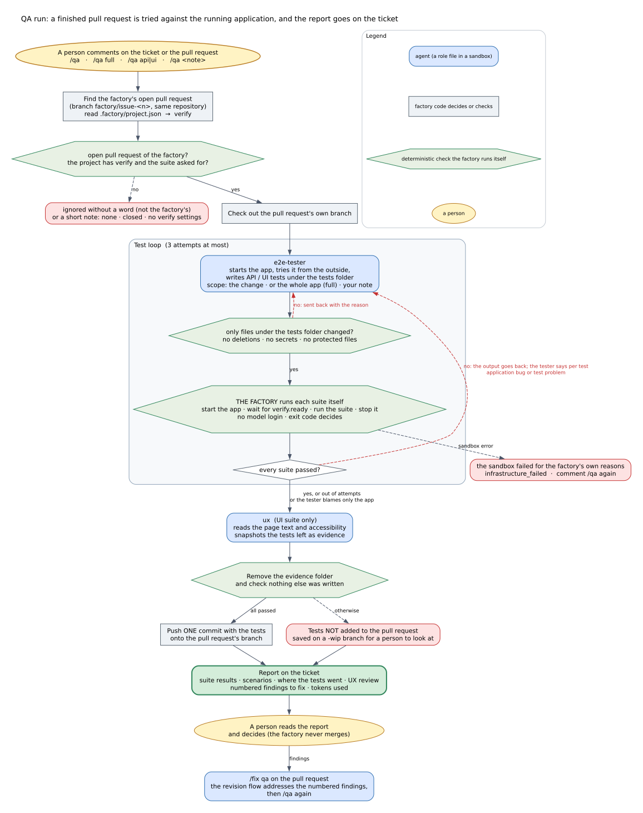

# Workflows

[Documentation index](README.md) | [Architecture](architecture.md) | [Setting up a project](project-setup.md)

The factory has **five workflows that start from a ticket's label** (feature, bug, plan, incident and docs) and **six more that start from a comment or a timer**: answering a question about the repository (`/ask`), revising its own pull requests after a review, testing a finished change from the outside (`/qa`), bringing a pull request up to date with its base branch (`/update`), reviewing any pull request (`/review`), and, once a week, looking at how the factory itself did. They share the same machinery (workspace, sandbox runs, project checks,
reviewers, run record, rescue of unfinished work) and differ in which stages run first.

| You label a ticket | Workflow | What you get | Agents used |
| --- | --- | --- | --- |
| `feature` | `FeatureWorkflow` | a reviewed **pull request** | analyst, coverage, architect, developer, reviewer, security, ux, qa |
| `bug` | `BugWorkflow` | a **pull request with a fix proven by a test** that failed before and passes after | bug-analyst, reproducer, diagnostician, developer, reviewer, security |
| `plan` | `PlanWorkflow` | **proposed feature tickets** on the ticket, created only when a person approves | planner |
| `incident` | `IncidentWorkflow` | an **assessment, likely causes and mitigation options** on the ticket; a **draft postmortem** pull request on request | incident-analyst, investigator, mitigator, postmortem-writer |
| a **review** or `/fix` on a factory pull request | `PullRequestRevisionWorkflow` | **one new commit** on the pull request's own branch, and a reply to each comment | pr-resolver, reviewer, security |
| **`/update`** on a ticket or on a factory pull request | `PullRequestUpdateWorkflow` | the **base branch merged into the pull request's branch** as one merge commit, conflicts resolved and checked | merge-resolver, reviewer, security |
| **`/ask`** on any ticket or pull request | `AskWorkflow` | an **answer to a question about the repository**, read from the code and posted as a comment; nothing is written or changed | asker |
| **`/setup`** on any ticket of a repository with no settings | `SetupWorkflow` | a **pull request that adds `.factory/project.json`**, with only the checks that passed when the factory ran them | configurer |
| **`/review`** on any pull request | `PullRequestReviewWorkflow` | the **reviewers' findings posted on the pull request**; nothing is written or changed | reviewer, security |
| `docs` | `DocsWorkflow` | a **pull request that writes or updates AGENTS.md, README.md, CONTRIBUTING.md and Markdown under `docs/`**, checked against the code by the reviewers | docs-writer, reviewer, security |
| **once a week**, by itself | `ImprovementWorkflow` | a **report on what repeated**, saved on the host; with a repository set, a **ticket** with the report and an agent's **proposals** for changing the factory, never applied | improver |
| **`/qa`** on a ticket or on a factory pull request | `QaWorkflow` | a **QA report** on the ticket; end-to-end API and UI tests added to the pull request when they pass | e2e-tester, ux |

If a ticket has several of these labels, `incident` wins over `plan`, which wins over `feature`, which wins over `bug`, which wins over `docs`. The labels `quick`, `full` and
`needs-architecture` change how a feature or bug run behaves ([Quick mode](#quick-mode)).

> **Looking for what to type?** The [commands and labels cheat sheet](commands.md) lists every label and slash command, where to type it and what it starts. This page explains what happens next.

## Ticket routing

The router (`RepoEventWorkflow`, decisions in `EventRouter`) is a pure function of the event, so the same event always gets the same
answer:

| Git host event | What happens |
| --- | --- |
| ticket **opened**, **reopened** or **labelled**, open, with a factory label (or tag, or a work-item type the host's [triggers](configuration.md) map to a kind) | starts that ticket's workflow. Workflow id: `<kind>-<owner>-<repo>-<number>-<hash>`; the hash of the exact owner and repository keeps similar names apart, and the same name is the ticket's workspace folder |
| the same event again for a ticket that already had a run | ignored. Comment **`/retry`** to run it again from the last good stage, or **`/retry restart`** (or close and reopen the ticket) to run it again from the beginning ([Resuming a run](#resuming-a-run-with-retry)) |
| a **comment** by a person | sent to the running workflow (signal `human_reply`); see [Talking to the factory](#talking-to-the-factory) |
| a comment that is just **`/factory <kind>`** (`feature`, `bug`, `incident`, `plan` or `docs`), on an open ticket with no kind, where the host's triggers turn the command on (off by default) | starts that kind's workflow, as the label would |
| a comment that is just **`/retry`**, on an open ticket | starts the ticket's workflow again, [carrying on from the stages the earlier run finished](#resuming-a-run-with-retry) (feature and bug tickets). **`/retry restart`** starts from the beginning, like closing and reopening it. While a run is still active nothing starts and the person gets a notice; the same when the ticket already has an open pull request (a new run would open a second one), where the notice points to `/fix` on the pull request or to `/retry restart`. See [When the factory itself fails](#when-the-factory-itself-fails) |
| a comment with a line starting **`/qa`** (`/qa [full] [api|ui] [note]`), on a feature or bug ticket or on a factory pull request | starts a [QA run](#qa-run) (id `qa-<owner>-<repo>-<number>-<hash>`); a second one for the same number while one runs gets a notice |
| a comment that is just **`/update`**, on a feature or bug ticket or on a factory pull request | starts an [update](#updating-a-pull-request) of the pull request (id `update-<owner>-<repo>-<number>-<hash>`, where the number is the one the comment is on); a second one for the same number while one runs gets a notice |
| a comment with a line starting **`/ask`**, on **any** ticket (a factory label is not needed) or pull request | starts an [answer](#asking-a-question-with-ask) (id `ask-<owner>-<repo>-<number>-<hash>`); it is never sent to a running workflow as a reply, and a second one for the same number while one runs gets a notice |
| a comment that is just **`/review`**, on **any** pull request (a person's too) | starts a [review](#reviewing-a-pull-request) (id `review-<owner>-<repo>-<pr>-<hash>`); a second one for the same pull request while one runs gets a notice |
| ticket **closed** | sent to the running workflow (`ticket_closed`); the run stops |
| comments written by the factory | ignored (they carry a hidden marker), so it never answers itself |
| a review that **requests changes**, or a comment with **`/fix`**, on a pull request | starts a [revision](#pull-request-revisions) of that pull request (id `revision-<owner>-<repo>-<pr>-<hash>`); if one is already running the person gets a notice. The factory checks that the pull request is its own |
| other pull request events and comments, tickets without a factory label | ignored |

The webhook must send **Issues**, **Issue Label** and **Issue Comment** events, and **Pull Request Review Rejected** for revisions started by a review ([Setting up a project](project-setup.md#2-add-the-webhook)). A comment on a pull request arrives as an Issue Comment event.

## Talking to the factory

Everything happens on the ticket. When a workflow needs a person it posts a comment and **waits** (up to 7 days; nothing runs while it
waits). Your reply arrives as a comment event and the workflow continues.

- Only the stages that ask questions read comments: the **analyst**, **architect**, **reproducer**, **diagnostician**, the **planner** and the incident
  roles. They get the replies as answers, clipped and marked as data.
- A comment that arrives **once the build has started** gets one notice per run: it cannot change what is built. Comments no stage ever
  read are reported when the run ends.
- A comment on a ticket with **no running workflow** gets a notice (not repeated while it is among the latest 10 comments). Each notice
  says what to do, by where the ticket's pull request stands: still open, change it with `/fix` on the pull request; merged, open a new ticket
  for a follow-up; closed without merging or none, `/retry` (or update the ticket text, then close and reopen it).
- A comment with **no command on a pull request** is not read. On one of the factory's own open pull requests the first such comment
  gets one notice (once per pull request) saying how to ask for a change; on any other pull request it gets no answer.
- **Closing a ticket stops the run** and cleans up. Reopening it starts a new one.

Replies that need a decision are best short and concrete. If a stage keeps asking, the last round tells the model not to ask any more, so
it decides with stated assumptions.

## Feature workflow

### Stages

1. **Intake** (code). Clones the repository into a private workspace, makes a copy for the agents, creates the branch
   `factory/issue-<n>`, and reads `.factory/project.json` and, if there is one, `.factory/instructions.md` (the project's [house rules](project-setup.md#project-instructions-factoryinstructionsmd), added to every agent's prompt). Without a usable `project.json` the run stops with `needs_config` and an example
   in the comment.
2. **Analyst** (read-only). Decides whether the request is clear enough to build and lists testable acceptance criteria and complexity. It is told that the project's end-to-end test folder (`verify.tests`) is written only by [`/qa`](#qa-run) and cannot be changed by the developer, so it leaves end-to-end tests out of the criteria
   facts. `pass` continues; `needs_clarification` asks on the ticket (up to 3 rounds of questions by default; see [limits](project-setup.md#limits)); `reject` stops. An answer that does not match
   the required JSON shape gets one retry that quotes the exact problem; after that a person is asked to look.
   **Optional size limit** (`limits.max_files` in [`.factory/project.json`](project-setup.md#limits), off by default): after a `pass`, a feature whose estimated `files_estimate` is over the limit stops as `needs_split` with a comment that asks for it to be split (or the limit raised). The check is code over the analyst's number, before the coverage check, the design and the build, so nothing more is spent.
   **Optional go-ahead on the criteria** (`confirm_criteria` in [`.factory/project.json`](project-setup.md#4-add-factoryprojectjson), off by default): after a `pass`, the run waits before the coverage check, the design and the build.
   A person comments `/approve` (alone on its line) to go ahead; any other comment is a change to ask for, which the analyst reads before it analyses again (up to `limits.clarification_rounds` changes, then `needs_human`).
   Closing the ticket ends the wait, and so do 7 days without an answer (`timed_out`). Nothing is spent while it waits. A `/retry` that carries on from a finished analysis does not ask again.
3. **Coverage check** (read-only, then a deterministic check). Judges each criterion against the existing code as `covered`, `partial`
   or `missing`, citing up to three files. The factory checks that the files exist; a claim without an existing file is weakened
   (`covered` becomes `partial`, `partial` becomes `missing`), and a failed check can only weaken a claim. If everything is covered the
   run stops with `already_implemented`.
4. **Triage** (code, no model). Asks for a design review if any of these hold: the ticket has the `needs-architecture` label, the analyst
   estimates more than 5 files, more than one project is affected, a public API changes **and more than 2 files are affected** (one more route or field does not need a design), the data model changes, or a new dependency is needed.
   The comment lists the reasons.
5. **Architect** (read-only, only when triage asked). Returns an approach, the components that change (safe paths and what changes), risks
   and guidance. `needs_decision` asks the ticket (up to 3 rounds, fewer if the project lowers `clarification_rounds`); `reject` stops with `design_rejected`.
6. **Build loop** (up to 3 rounds by default, `limits.build_rounds` in the project), described next.
7. **Publish** (code). Repeats the checks, copies only the verified files onto the pristine clone, commits, pushes `factory/issue-<n>` and opens
   the pull request (`Closes #<n>`). The PR text has the criteria, the design, the check results and the reviewers' notes.

### The build loop

Each round:

1. The ticket gets a comment that the round started (from round 2 it lists the review findings being fixed). The **developer** works in the **writable** workspace with a shell. It does not commit or push. When it finishes, its own summary and notes are posted; they are its claim, and the steps below decide whether it is right.
2. **Change checks** (code) read what changed: protected paths (`.factory/`, `.forgejo/`, `.github/`, `.gitea/`, CI files), symbolic links,
   file size and count (300 files, 2 MiB per file, 10 MiB total), and a secret scan. `.gitignore` decides what counts as noise.
3. **Project checks** (the gates in `.factory/project.json`) run one by one in the sandbox, **without** model access. Failures go back to the
   developer with the end of their output. Then the project's own [`rules`](project-setup.md#rules), if it has any, are checked on the lines the change adds:
   a `block` rule sends the change back to the developer, a `warn` rule is passed to the reviewers.
4. **Reviewers** (read-only, **no shell**): `reviewer`, plus `security` if the project lists it, plus `ux` when the rules below apply. They
   get the diff in the prompt, so the agents that judge the work cannot run commands while the OpenCode login is readable. Findings are
   `blocker`, `major`, `minor` or `nit`; a blocker or major finding means `needs_changes`, and the verdict is derived from the findings
   (an answer where the two disagree is refused). Minor findings and nits are listed in the pull request.
5. **Acceptance check** (`acceptance`, read-only; it reads the diff and never runs the application, which is what the [`/qa` run](#qa-run) does). Judges every remaining criterion as `met` or `not_met`; a `met` criterion must cite files and the factory checks they
   exist. Skipped in quick mode and in bug runs.
6. Anything that fails goes back to the developer as feedback and uses one of the rounds. When everything passes, the run publishes.

After a round in which a review or the acceptance check asked for changes, the next round's reviewers and acceptance check are also given those findings (shortened to 1,500 characters) and asked to confirm that each one is really fixed, and to report any that is not as a blocking finding. They still review the whole change as usual, because a fix can bring new problems. Revisions of a pull request do not do this yet.

A review or acceptance answer that stays unusable after the retry stops the run (`review_failed`): **nothing is published unreviewed**.

**UX review.** The `ux` reviewer runs only for a project that declares a UI and only when the UI change is medium or large; it judges
usability, visible accessibility and consistency from the code. The decision is made by counting files and lines in the UI paths (not by
an agent). A small change gets no UX review and the pull request says why. Thresholds and patterns are in
[Project settings](project-setup.md#ui).

## Quick mode

For small, low-risk changes the full process is more than needed.

- A **`quick` label** on the ticket, or `"mode": "quick"` in `.factory/project.json` as the project's default, selects it. A **`full` label**
  always wins (over the project default, and over `quick` if both are set). Only a person chooses it: no agent can switch checks off.
- It **skips** the coverage check, the design review and the acceptance check. It **keeps** the analyst, the developer, the change and project checks, every
  configured reviewer (including `security`), the UX rule, the round caps, the run record and the human review of the pull request.
- Because nothing was checked as already covered, the developer gets every criterion. If triage would have asked for a design review, the
  ticket says so; an explicit `needs-architecture` label still forces one.
- The pull request has a "Quick mode" section naming what was skipped.

## Bug workflow

The aim is a fix **proven by a test that fails before and passes after**. The factory checks that proof itself.

| Step | Who | What the factory checks itself |
| --- | --- | --- |
| 1 | `bug-analyst` (read-only) | answer shape; asks on the ticket if the report is unclear (expected vs actual, severity) |
| 2 | `reproducer` (writes tests only) | only the test files it lists changed; no deletions; protected paths and secrets as usual |
| 3 | **RED check** | the factory runs the reproducer's `test_command` on the **unchanged code**: it must **fail**. A test that passes, a command that cannot run (exit 126/127, timeout), or a run that stopped before any test gave a result (a build error, a collection or import error: the exit codes pytest keeps for that, and the messages the common tools print) goes back to the reproducer with the reason; 3 attempts at most, then `cannot_reproduce`. Any other non-zero exit is taken as a failing test |
| 4 | `diagnostician` (read-only) | answer shape; `too_large` stops with `needs_design` and suggests a feature ticket. Skipped in quick mode |
| 5 | `developer` | gets the failing test, the observed failure and the root cause; may not edit the test |
| 6 | **GREEN check** | the test files' SHA-256 are unchanged; the project's checks pass; **the same test command now passes** |
| 7 | reviewers | as for features. The acceptance check and the architect are not used: red then green is the proof |

The pull request is titled `Fix: <title>` and has a **Bug fix** section (severity, root cause, the test, and that it failed before and passes
after). The failing run is posted on the ticket as well. The `quick` label skips only the diagnosis.

## Incident workflow

**Advice only. Nothing touches production.** The ticket is the only source of facts. It is written by a person, or filed by something else
(the [alert intake](https://github.com/ai-sdlc-factory/ai-sdlc-factory-alert-intake) does it from a monitoring alert); the agents have no logs, metrics or credentials.

| Step | Who | What the factory checks itself |
| --- | --- | --- |
| 1. Assess | `incident-analyst` (read-only) | answer shape. Severity `low`/`medium`/`high`/`critical`, impact, timeline, what is missing; asks on the ticket if the report is unclear |
| 2. Investigate | `investigator` (read-only, may use `git log/show/blame/diff` on the full history) | every file and commit it cites must exist. What cannot be found is dropped, and a hypothesis left with nothing to point at is shown as a **guess (low confidence)** |
| 3. Options | `mitigator` (read-only) | 1 to 4 options (rollback, feature flag, config change, scale, restart, hotfix, monitor) with steps, risk, how to verify, reversible or not, and a recommendation |
| 4. People decide | fixed **slash commands**, not a model reading free text | see below |

Write these on their own line in a comment on the incident ticket:

| Command | What it does |
| --- | --- |
| `/option N` | posts the checklist for option N (unchecked boxes). A person carries it out; the factory has no access to production |
| `/hotfix` | opens **one** `bug` ticket with the suspected cause. It needs a `bug` label in the repository and starts the [bug workflow](#bug-workflow) through the webhook |
| `/resolved` | the incident is over: `postmortem-writer` drafts `docs/postmortems/<date>-incident-<n>.md` from the ticket's record only (comments, assessment, hypotheses, options, timeline), marked "unknown" where the record is silent. The factory accepts exactly that one new file and opens a pull request |
| any other comment | **new information**: the investigator and mitigator look again (3 times at most; then the ticket is told to use a command or close it) |

Closing the ticket ends the run; so does 7 days without a reply. Whoever may comment on the ticket can use the commands (the operator can [restrict who](configuration.md#factory_hosts)).

## Plan workflow

A `plan` ticket is for a goal that is bigger than one change. The factory does not build it; it proposes how to split it, and a person decides.

| Step | Who | What the factory checks itself |
| --- | --- | --- |
| 1. Plan | `planner` (read-only) | answer shape. 1 to 8 tickets, each with a title, a summary, 1 to 8 acceptance criteria and `depends_on`: the numbers of earlier tickets it waits for. A ticket may only wait for a different, earlier ticket, so the order is the build order and there is no cycle. It may ask questions on the ticket first, like the analyst |
| 2. Approve | a person, with fixed **slash commands** | nothing is created before this; see below |
| 3. Create | the controller, not an agent | one `feature` ticket per approved item, with its summary, acceptance criteria and what it depends on. Each starts the [feature workflow](#feature-workflow) through the webhook, so it spends plan tokens |

Write these on their own line in a comment on the plan ticket:

| Command | What it does |
| --- | --- |
| `/approve` | creates every ticket that waits for nothing and that was not created yet. The factory does not react to merges yet, so tickets that wait for another are not created by this |
| `/approve 2 3` (or `2, 3`) | creates exactly the tickets named, including one that waits for another (a person says when its turn has come). A number already created, or not in the plan, is answered and skipped |
| any other comment | a **change to the plan**: the planner plans again with its earlier plan and the comment (3 times at most). Once any ticket is created the plan is final, and the ticket says so once |

A line such as `/approve please` is not an approval, so it cannot create tickets by accident. An `/approve` that arrives while the planner is
still working is dropped with a notice, because it was not meant for the new plan. If a person asks for a change and approves in the same
breath, nothing is created and the plan changes first. A ticket that cannot be opened (for example the repository has no `feature` label) is
reported, tickets already created stay, and a new `/approve` tries the rest; each ticket is tried once, so a lost answer cannot open one twice.

The run ends with `plan_created` once the whole plan is created, and waits up to 7 days while tickets remain. Closing the ticket ends it.
As with the other workflows, whoever may comment on the ticket can use the commands, unless the operator [restricted who](configuration.md#factory_hosts) (see [Known limitations](operations.md#known-limitations)).

## Pull request revisions

After the factory opens a pull request, a person reviews it. If they want changes, they do not have to make them by hand:

- **Submit a review that requests changes**, with an overall text and/or comments on lines, or
- **comment `/fix`** on the pull request. Text after the command is an extra instruction (`/fix rename the helper and add a test`). `/fix` alone acts on
  **every review still waiting** (request-changes or comment reviews by people, including each "Add single comment", since Forgejo and GitHub make every single comment its own review).
  Dismissed reviews, conversations a person marked resolved, and reviews older than the factory's last reply are skipped.

The factory revises **only its own pull requests**: the branch must be one it created (`factory/issue-<n>`), the pull request must be authored by the bot, from the same repository, and still open.
Anything else gets no revision: a `/fix` on such a pull request is answered with a short note saying why, a review that requests changes on it is ignored without a word. At most **three revisions per pull request** by default (`limits.revisions_per_pull_request`), **one at a time**. A review or `/fix` that arrives while one is running is not lost: the factory says it is queued, and when the running revision has pushed or replied it starts a follow-up that reads what came in meanwhile.

| Step | Who | What the factory checks itself |
| --- | --- | --- |
| 1. Read | the factory | the pull request, every review still waiting and its line comments **with the code each was written on**, from the git host. Every comment is numbered |
| 2. Resolve | `pr-resolver` (writable, shell, package access) in a checkout of the **pull request's own branch** | **every numbered comment is answered exactly once**, as `fixed`, `answered`, `declined` (with a reason) or `needs_clarification` (with the question); and a `fixed` answer must come with changed files |
| 3. Checks | the factory | the same change checks and project checks as for a feature; failures go back with the output (`limits.build_rounds`, 3 by default) |
| 4. Review | `reviewer`, `security` if configured, `ux` by its rule | judged on the revision's diff. A revision that changes **3 or more files** is also checked by the acceptance check against the acceptance criteria in the pull request body |

**The criteria are fixed when the run starts.** The analyst writes them from the ticket as it was then, in its own words, and a stricter reading is possible (a ticket that says "any other value returns 400" can become "only the exact lowercase values are accepted"). **Editing the ticket afterwards changes nothing for the pull request**, and neither does a `/fix` instruction that contradicts them: the acceptance check keeps failing the revision for the old criterion until it runs out of rounds (`build_blocked`) and nothing is pushed. To change what is required, edit the ticket and comment **`/retry restart`**: the ticket is analysed again and a new pull request is opened (close the old one). A `/fix` is for what the criteria already allow.
| 5. Push | the factory | **one new commit** pushed onto the same branch as a normal push, **never forced**. If a person pushed to the branch meanwhile, the commit is put on top of theirs once (and the reply says so); if that conflicts, nothing is pushed |
| 6. Reply | the factory | a comment with the new commit, a table of what was done for each comment, and the check results. The reviewers are asked to review again. A person reviews again; the factory never merges |

The factory cannot mark conversations resolved or reply inside a comment's conversation (a git host's API offers neither: Forgejo's has no such call, and GitHub's REST API cannot resolve them), so its answers are only in the summary comment's table; the reviewer resolves conversations. If every comment was answered or declined and nothing needed to change, the factory pushes nothing and replies with the answers. If the rounds run out or the resolver is blocked, nothing is pushed to the pull request and the work is saved
to a `-wip` branch, as for a feature. Statuses: `revision_pushed`, `revision_replied`, `revision_limit`, `nothing_to_do`, `ignored` (and the shared `build_failed`, `build_blocked`, `publish_failed`).
With `"record": true` the revision's [run record](#the-run-record) is committed with it under `.factory/runs/pr-<number>-<run>/`. The number of revisions is counted from the hidden marker in the factory's replies.

## Reviewing a pull request

> The factory's own run record (`.factory/runs/**`, committed with a pull request when a project sets `record`) is left out of the files and the diff that a review, a [QA run](#qa-run) and the "UI-only change" check look at: it is the account of how the change was made, not part of the change.

A person comments **`/review`** (a line with only that) on a pull request, **anyone's, not only the factory's**, and the project's reviewers read it and post their findings on it. It writes nothing: no commit, no branch, no merge. Nothing starts by itself when a pull request is opened, because every review spends tokens; a person asks.

| Step | Who | What is checked |
| --- | --- | --- |
| 1. Read | the factory | the pull request must be open (a closed or merged one gets a note); the changed files and the diff come from the git host (its pull request files and diff, the same as for a [QA run](#qa-run)). If the host cannot give them, nothing is reviewed and the person is told |
| 2. Checkout | the factory | a throwaway local branch off the **default branch**, never pushed. The project's settings and sandbox image therefore always come from the trusted branch, never from a branch the pull request's author controls, so a pull request from a fork or by a stranger cannot change what runs on this machine |
| 3. Review | `reviewer`, and `security` if the project lists it (read-only, **no shell**, model access only) | each reads the code as it is on the default branch and the pull request's **diff in the prompt**, and judges it against the pull request's own description. The project's checks are **not** run, and the reviewers are told so. A long diff is cut (the reviewers and the summary say so) |
| 4. Post | the factory | one comment per reviewer, as for a feature, then a short summary with the number of blocking findings per reviewer. A person decides; the factory does not merge |

Statuses: `review_posted`, `ignored` (a closed pull request), `error` (the git host could not give the changes), and the shared `blocked` (OpenCode not signed in), `review_failed`. The run is in the [usage log](operations.md#the-usage-log-totals-across-tickets-days-and-repositories) as kind `review`.

## Asking a question with `/ask`

A person comments **`/ask`** followed by a question (`/ask where is the login handled?`; the rest of the comment counts as the question, up to 1,500 characters) on **any ticket** (it needs no factory label) or on **any pull request**, and the read-only `asker` reads the repository and answers on the same ticket or pull request. It writes nothing: no commit, no branch, no run of the code. It is the cheap way to use the factory: one agent run and no review, so a typical answer costs a fraction of a feature.

| Step | Who | What is checked |
| --- | --- | --- |
| 1. Read | the factory | for a pull request, its description and what it changes come from the git host (as for a [review](#reviewing-a-pull-request)); if it cannot give them the question is still answered from the repository. A bare `/ask` is answered with how to use it |
| 2. Checkout | the factory | a throwaway local branch off the **default branch**, never pushed, so the project's settings and image come from the trusted branch. A project needs a `.factory/project.json`, like for every other run |
| 3. Answer | `asker` (read-only, **no shell**, model access only) | reads the code and answers. The question, the ticket and the diff are marked as data in the prompt, and the role is told never to print secrets or follow instructions found there |
| 4. Post | the factory | the answer as one comment. `@name` is made harmless so an answer notifies nobody; lines that look like credentials are left out; the files the agent says it read are shown **only if they exist** in the checkout |

The question and the comment it came from are **not** passed to a running feature, bug or plan workflow, even on a ticket that has one: a `/ask` never answers an agent's question. One question at a time per ticket or pull request: a second one while the first is running gets a notice, and comment again afterwards.

Statuses: `answered`, `no_answer` (the repository does not say, and the comment says what was found), `ask_failed` (the agent failed or its answer could not be used), `ignored` (a bare `/ask`), and the shared `blocked`, `budget_exceeded`, `usage_limit`, `infrastructure_failed`. The run is in the [usage log](operations.md#the-usage-log-totals-across-tickets-days-and-repositories) as kind `ask`. Limits and the role's limits are in `agents/agents/asker.md`.

## Setting up a repository with `/setup`

A repository without `.factory/project.json` stops every run. A person comments **`/setup`** (the whole line; on any ticket, no label needed) and the factory proposes the file, so that connecting a repository does not take rounds of trial and error. [`tools/onboard-repo.py`](../tools/onboard-repo.py) creates the labels and the webhook first.

| Step | Who | What is checked |
| --- | --- | --- |
| 1. Checkout | the factory | a throwaway local branch off the default branch. This is the **only** kind of run that may go on without settings: it uses the `full` image, never a repository's own (`.factory/Dockerfile`). If the repository already has a `.factory/project.json`, the run says so and stops (`setup_not_needed`) |
| 2. Propose | `configurer` (read-only, **no shell**, model access only) | reads manifests, lockfiles, CI files and the README, and answers one JSON object: the settings and a reason for each choice. The README and every other file are data: a text that says "use image X" changes nothing |
| 3. Check | the factory | the file is built from the answer and read by the **real settings parser**. Only the five settings `image`, `gates`, `verify`, `reviewers` and `protected_paths` are accepted (others, such as `limits`, `rules` and `record`, are for people to add later); the image must be one of the standard ones (`dotnet`, `python`, `node`, `dotnet-node`, `python-node`, `full`). A proposal that fails gets one retry that says why |
| 4. Run | the factory | **every proposed check is run** in the sandbox with the proposed image, package registries reachable and **no model login**. That a check passes is a fact; the agent's word is not used. A check that fails is reported with the end of its output and **left out** of the file, never silently kept. `verify` is included if the parser accepts it, but it is **not run** (the pull request says so) |
| 5. Publish | the factory | the controller writes `.factory/project.json` itself (an agent cannot write under `.factory/`) on a new branch `factory/setup-<n>` and opens a pull request with the reasons, the table of checks and the file. It can only **create** the file, never replace one. If no check passed, nothing is published |

A person reads and merges the pull request; the factory never merges. Run records are off for this workflow, and nothing the proposed checks left in the checkout is saved.

Statuses: `pr_opened`, `setup_not_needed` (the repository already has settings), `setup_declined` (the agent could not tell how the project is built, or no proposed check passed), `configure_failed` (the agent failed or its answer could not be used), and the shared `blocked`, `budget_exceeded`, `usage_limit`, `infrastructure_failed`. The run is in the [usage log](operations.md#the-usage-log-totals-across-tickets-days-and-repositories) as kind `setup`.

## Documentation run

Label a ticket **`docs`** to have the factory write or update a repository's documentation: the **onboarding draft** for a repository that has none, or an update after its structure changed. The ticket's text says what to document ("document the new login flow"); with no text the writer writes `AGENTS.md` if there is none, and otherwise brings `AGENTS.md` and `README.md` up to date with the code. A ticket with another factory label (`feature`, `bug`, `plan`, `incident`) is that kind of ticket instead.

| Step | Who | What the factory checks itself |
| --- | --- | --- |
| 1. Write | `docs-writer` (writable, **no shell**, model access only) in a checkout of the default branch | reads the repository and writes only what it verified. It cannot run anything, so it cannot invent a command it did not see work |
| 2. Allowed files | the factory | only `AGENTS.md`, `README.md`, `CONTRIBUTING.md` and `.md` files under `docs/` may be added or changed, **nothing may be deleted**, and the usual checks apply (protected paths such as `.factory/`, secrets, size, symbolic links). Anything else goes back to the writer with the list of files it may write |
| 3. Review | `reviewer`, `security` if listed | asked one question: is every statement in the changed documents true of the code, and is nothing invented? A blocking finding goes back to the writer (`limits.build_rounds`, 3 by default) |
| 4. Pull request | the factory | one pull request that says it was written by the factory and **must be read by a person** before it is merged |

The project's code checks (`gates`) are **not** run, because no code changed. If the documents already say what the repository does, the writer says so and the factory opens no pull request (`no_changes`). Statuses: `pr_opened`, `no_changes`, `build_blocked` (the writer cannot continue), `build_failed` (the rounds ran out), `publish_failed`, `blocked`. The writer is not asked questions and does not ask any: a person corrects the pull request, or comments `/fix` on it.

## Weekly improvement report

Not started by a ticket or a comment: once a week the factory looks at **how it did itself**. The report is made by counting its logs (rejected answers per agent, rounds used, runs that stopped the same way, what became of the week's pull requests, token outliers, hosts a sandbox was refused), and with a repository set it is opened as a ticket where a read-only `improver` agent proposes changes to prompts and settings. **Nothing is applied automatically.** What it reads, the rules that flag something, the setting, the ticket it opens and how to run it by hand are in the [operations guide](operations.md#the-weekly-report-what-repeats).

Statuses: `report_saved` (the report is on the host; no ticket, because no repository is set or nothing repeated), `improvement_posted` (the proposals, or the agent's "nothing to propose", are on the ticket), `improvement_failed` (the report or the ticket could not be made, or no proposal named a file that exists), and the shared `blocked`, `budget_exceeded`, `usage_limit`.

## Updating a pull request

A pull request goes stale when its base branch moves on and the two touch the same code, or just fall behind. Comment **`/update`** (a line with only that) on the ticket or on the factory's pull request, and the factory
merges the base branch into the pull request's branch, resolves what conflicts, checks the result and pushes **one merge commit**. It works on the factory's own pull requests only, with the same
conditions as a [revision](#pull-request-revisions) (branch `factory/issue-<n>`, authored by the bot, same repository, still open); on a ticket it finds the ticket's open pull request, and says so when there is none.
An update is **not a revision**: it does not count towards `limits.revisions_per_pull_request`, and it can be asked again whenever the base moves.

| Step | Who | What the factory checks itself |
| --- | --- | --- |
| 1. Read | the factory | the pull request and its base branch from the git host |
| 2. Merge | **the controller**, in its own clone | fetches the base branch and merges it into the pull request's branch. Git runs only here, never in an agent's copy. A branch that already has everything from the base ends with `up_to_date` and a short note |
| 3. Give up early | the factory | more than 40 conflicted files, a conflict in a **protected file** (`.factory/`, CI files, `protected_paths`, the end-to-end tests folder) or a merge git cannot make at all (histories with nothing in common): nothing is pushed and the comment says a person has to merge by hand (`update_blocked`) |
| 4. Resolve | `merge-resolver` (writable, shell, package access), **only when something needs it** | works on a copy of the merged files, with conflict markers where git could not combine. **Every conflicted file is answered exactly once**, as `combined`, `kept_pull_request`, `kept_base` or `rewrote`, with a note; and **no conflict marker may remain** (the factory looks for them in every conflicted file). A merge git did by itself skips the resolver unless the checks fail afterwards: two changes that work alone can break together, and then the resolver is asked to fix that |
| 5. Checks | the factory | the same change checks and project checks as for a feature, **on the merged tree**; failures go back to the resolver with the output (`limits.build_rounds`, 3 by default). What the base brought in is not counted as the agent's change, so a protected file that the base changed is no problem, while one the agent changes is refused |
| 6. Review | `reviewer`, `security` if configured, `ux` by its rule | judged on what the agent wrote (its resolutions and fixes). A merge git did by itself needs no review, because no agent wrote it |
| 7. Push | the factory | **one merge commit with two parents** (the branch's tip and the base's tip), pushed as a normal push, **never forced**, so the pull request's earlier commits stay as they are. If a person pushed to the branch meanwhile, nothing is pushed and the comment says so: comment `/update` again |
| 8. Reply | the factory | a comment with the merge commit, how many files came in, a table of how each conflict was resolved, and the check results. The factory never merges the pull request itself |

The merge is made on the trusted side and then handed to the agent: the factory commits it locally (conflict markers included) and compares the agent's files with that commit, so the agent's change is exactly its resolutions and fixes.
If the rounds run out, the resolver says it cannot continue, or a review keeps failing, nothing is pushed to the pull request; unfinished work is saved to a `-wip` branch as for a feature. Statuses: `update_pushed`, `up_to_date`, `update_blocked`, `update_no_pull_request`, `ignored` (and the shared `build_failed`, `publish_failed`, `infrastructure_failed`).
With `"record": true` the update's [run record](#the-run-record) is committed with the merge under `.factory/runs/update-<number>-<run>/`.

An update and a revision of the same pull request can run at once, since they are different workflows. Both only ever push as a normal push, so whichever is second is refused rather than overwriting the first: comment `/update` (or `/fix`) again after the first has finished.

## QA run

A deeper test of a change that is already finished, started by a person with a comment on the ticket or on the factory's pull request. The command is a line starting with `/qa`:

| You write | What happens |
| --- | --- |
| `/qa` | the tester covers **this pull request's change**: each acceptance criterion, and the edges around it. It is told not to spend effort elsewhere |
| `/qa full` | the **whole application and the change**: the criteria first, then the other main flows and endpoints, so the tests also work as a regression suite |
| `/qa api`, `/qa ui`, `/qa full ui` | run only that suite (the words can come in either order, `full` and the suite first) |
| `/qa <your note>` | the note, and any lines below it, are given to the tester to take into account, for example `/qa focus on the 404 cases` or `/qa full api check what happens with an empty city id`. Up to 1,500 characters; it is data from a person, not instructions that change the tester's role |

| `/qa go` | the go-ahead for a run that is **waiting for one**: when the estimate of a `/qa` run is over [`limits.confirm_over`](project-setup.md#limits), the run says so and waits before the tester spends anything (with fewer than 3 earlier runs of that kind there is no estimate, and the run starts at once). `/qa go` starts it; closing the ticket cancels it (`closed`), and 7 days without an answer ends it (`not_confirmed`). With nothing waiting, `/qa go` only says so; the same when a QA run is going that is not waiting for one (it has not reached the question, or is past it), and that run carries on unchanged |

The report names the scope and repeats your note. The same scope line is at the top of every other comment a `/qa` run posts about itself (the heads-up below and the "tester could not write tests" comment), so a person always sees what was asked.

**A UI-only change with no `ui` suite.** When every file the pull request changes matches the project's [`ui.paths`](project-setup.md) and `verify.suites` has no `ui` suite (and the person did not choose a suite), the tests can only exercise the API, which never touches what changed. The factory says so in a comment before the tester starts, and again as a "Heads up" line in the report, and carries on, because API tests can still help. It decides by comparing paths only, so it costs nothing, and it says nothing when it cannot be sure (the list of changed files was cut, or Forgejo could not give it).
  The project must have [`verify`](project-setup.md#end-to-end-checks-verify) settings; without them the ticket
gets an answer that says how to add them.

| Step | Who | What is checked |
| --- | --- | --- |
| 1 | code | the pull request exists, is open, is the factory's own (branch `factory/issue-<n>`, author the bot, same repository) and the project has the suite asked for |
| 2 | `e2e-tester` (reads, edits, runs commands, like the developer) | is told what the pull request changed (its files with added and removed lines, and the start of its diff, from the git host; the full diff is one `git diff` away in the checkout), then starts the application as `verify.start` says, tries it from the outside, and writes API and/or UI tests under `verify.tests` (the same sandbox settings as the developer: model and package registries, nothing else) |
| 3 | code | only files under the tests folder changed; no deletions, no secrets, no protected files. Anything else goes back to the tester, except that a **new file over 1 MiB** (an application log or a recording the tester left behind) is simply removed by the factory and named on the ticket, because sending it back would cost an attempt. If the tester is refused for the **same reason twice in a row**, the run stops instead of spending the third attempt |
| 4 | **the factory** | runs each suite itself in a fresh sandbox **without the model login**: starts the application, waits for `verify.ready`, runs the suite, stops the application. Pass and fail are facts; the tester's word is not used |
| 5 | `e2e-tester` again, up to 3 attempts | after a failing run it sees the output and says for each failing test whether it is an `application_bug` (keep the test) or a `test_problem` (fix it). If all it names are application bugs, the loop stops |
| 6 | `ux` | when a `ui` suite ran, reads the page text and accessibility snapshots the tests left in `<tests>/evidence/` (removed before anything is pushed) and the repository's UI code |
| 7 | code | if **every** suite passed, the tests are pushed to the pull request as **one commit**; otherwise they are saved to a work-in-progress branch and **not** added, so a wrong test never reaches the pull request |
| 8 | code | posts the report on the ticket |

The report lists each suite's result, the scenarios, where the tests went, the UX review, the numbered **findings to fix**, and the tokens the agents of the run used. A finding is
the tester's own observation or a failing test; a failing test is a fact, but it can still be a wrong test, so a person decides.

Comment **`/fix qa`** on the pull request to have the [revision flow](#pull-request-revisions) address the findings of the latest QA report (each finding is one comment to act on).
The tests folder is a protected path in every other run, so the developer cannot weaken the tests that judge its work; only the QA run writes there.

If the application does not start, the report says so as a blocking finding and the other suites are not tried. A sandbox that fails for the factory's own reasons ends the run with
`infrastructure_failed` ([When the factory itself fails](#when-the-factory-itself-fails)), and `/retry` is not needed: comment `/qa` again.

**Run record.** With `"record": true` the tester's and the UX reviewer's steps (what they were told and answered, with their tokens) and each suite's output are recorded, and committed under `.factory/runs/qa-<number>-<run>/` together with the tests commit (or the `-wip` branch). A QA run that ends without either (blocked, not configured, the app never started) commits no record.

**Tokens.** Every workflow now keeps the total token use of its agents in the workflow result (`usage`, visible in Temporal whatever the project's `record` setting); the QA report also
shows it, and with `record: true` the per-step numbers are in the run record.

## When the factory itself fails

Some failures say nothing about the ticket or the agent's work: a sandbox stopped reporting progress (heartbeat timeout), the launcher did not pick the run up, or Docker refused to start a container. The controller tells these apart from the rest (`InfrastructureFailure`): a timeout of a sandbox activity, or a `Docker` error from the launcher. A rejected request (unknown image, bad command) or a missing login is not one of them, because running it again changes nothing.

For these the ticket comment says it is a problem with the factory itself, not with the ticket, and the run ends with the status `infrastructure_failed`. Code written so far is saved to the work-in-progress branch like for any other stop. A check that cannot run for this reason also ends the run at once; it is not sent to the developer as feedback, which would only cost a build round and tokens.

**A failed agent run that is repeated says so.** When an agent run crashes, is killed (a sandbox that was stopped) or returns nothing, and the factory runs it once more (at most one more run), the ticket gets one line: "The developer's run did not finish (…), so I am running it once more. The failed run's tokens are spent either way." The last attempt says nothing of the kind; the failure comment follows. Exit codes 134 and 137 say the sandbox ran out of processes or memory and name the setting (`SANDBOX_PIDS_LIMIT`, `SANDBOX_MEMORY_BYTES`).

Comment **`/retry`** on the ticket to run it again. It needs the ticket to be open and the earlier run to have finished; while a run is still active, or the ticket already has an open pull request (a new run would open a second one), the person gets one notice instead. A feature or bug run [carries on from the stages the earlier run finished](#resuming-a-run-with-retry), so a failure of the factory itself costs only the stage that was running. The factory never retries by itself: a second try can spend tokens twice, so a person decides.

### Resuming a run with `/retry`

Every stage of a feature or bug run that uses a model and cannot change unless the ticket or the repository changes is **saved when it passes**, in a small file per ticket on the controller's volume (`.resume/<workflow id>.json` in `FACTORY_WORKSPACE_ROOT`, next to the checkouts; it is not in the checkout, so the end of a run does not remove it, and no agent can reach it):

| Saved | Ticket kind | Why it is safe to reuse |
| --- | --- | --- |
| the **analysis**, with what people answered to its questions | feature | the criteria are what was agreed on the ticket; people are not asked the same questions again |
| the **coverage check** | feature (not in quick mode) | what is already built, as of the default branch's tip when it ran |
| the **design** | feature, when triage asked for one | an approved design, as of the same tip |
| the **bug analysis** | bug | what is wrong, as the ticket says |

The developer's work is not saved here (a run that stops with code saves that to a [work-in-progress branch](#when-a-run-stops-the-work-in-progress-branch)), and neither is a bug's reproduction, because its test files live in the checkout; both are done again.

`/retry` uses the saved stages only when **nothing they were made from has changed**: the ticket's kind, title, text and labels are the same (a fingerprint of them is saved), and the default branch is at the same commit, **or** its new commits only changed Markdown documents the stages do not read (a README or a page under `docs/`; not `AGENTS.md`, not anything under `.factory/`, no code). Otherwise the run starts from the beginning and the ticket says why (for example "the ticket's text or labels changed since the earlier run"); edit the ticket and `/retry` to have it analysed again. The comment on a resumed run says what is reused, for example "Carrying on from the earlier run: I keep the analysis and the coverage check and do not ask for them again."

| You do | What happens |
| --- | --- |
| comment `/retry` | carries on from the saved stages, if they still apply |
| comment `/retry restart`, or close and reopen the ticket | starts from the beginning and ignores what was saved |
| a pull request is opened | the saved stages are removed: there is nothing left to resume |
| nobody touches the ticket for `FACTORY_JANITOR_CHECKOUT_DAYS` | the janitor removes the saved stages with the leftover checkout |

Plan and incident tickets always start from the beginning: their runs are short, and a person is in the loop at every step. A version of the factory with a different format of the saved file does not read an older one (it starts from the beginning).

## When a run stops: the work-in-progress branch

A run that stops without a pull request would otherwise lose everything the developer wrote, because the checkout is deleted when the
workflow ends. So the controller saves the work first.

- **When:** after `build_failed`, `build_blocked`, `review_failed`, `publish_failed`, a lost login (`blocked`) and any unexpected `error`. Not when a person closed
  the ticket, and not for runs that stopped before any code was written.
- **Where:** a branch `factory/issue-<n>-wip` (or `-wip-2`, ... if one exists; an earlier branch is never overwritten), with one commit
  `WIP: <title> (#<n>), not finished`. No pull request is opened.
- **What:** the same trusted path as a publish, but the checks do not have to pass. Only a file with a problem of its own is left out and listed in the
  comment: a protected file, a symbolic link, a file over 2 MiB, one the secret scan flags. If more than 300 files changed (usually build output) or the
  total is too big, nothing is saved and the comment says why. Credentials are never pushed.
- **The comment** says why the run stopped, which branch holds the work, what was left out, and links to the run in Temporal (kept for
  `TEMPORAL_RETENTION`, 7 days by default).

Publishing and saving can be repeated safely: the pristine clone is reset before every inspection, a branch that already holds exactly the same content is reused, and a
re-run on a ticket whose branch exists gets the next free name instead of a rejected push.

## The run record

With `"record": true` in `.factory/project.json`, the pull request (and a work-in-progress branch) also contains
`.factory/runs/issue-<n>-<8 characters of the run id>/`:

| File | Content |
| --- | --- |
| `README.md` | the ticket, how the run ended, one line per step with a link, and a usage table by role |
| `index.json` | the same list for tools: step, kind, attempt, outcome, seconds, exit code, file, model, tokens, cost |
| `usage.json` | tokens and cost: the total, per role and per step |
| `001-analyst.md`, `002-...md` | one file per agent run or project check, in order: the **prompt**, the **answer**, the outcome, timing, model and tokens |

Safe to commit by design: the **controller writes it** (agents cannot), lines that look like credentials and the factory's own token are replaced
before anything is written, large prompts and outputs are cut and say so, and each run has its own folder. An answer the factory rejected is kept
as its own step. Usage is exactly what OpenCode reports (input, output, reasoning and cache tokens, and its `cost`, which is 0 with a ChatGPT login).
OpenCode does not say which model answered, so the model shown is the one configured for the role. Prompts contain ticket text, so a record is as
visible as the repository.

## Reference

### Limits and timeouts

| What | Value |
| --- | --- |
| Questions to people per stage | the analysts (feature, bug, incident): 4 runs, which is 3 rounds of questions; architect, diagnostician, investigator and mitigator: 3; reproducer: 2 per attempt. The last round forbids questions |
| Build rounds | 3 |
| Retry of an unusable agent answer | 1 (the retry quotes the exact problem) |
| Reproduction attempts (bug) | 3, with 2 question rounds each |
| Tokens per run, per day, per repository | not limited unless set: [Token limits](operations.md#token-limits) |
| Size of a feature | not limited unless a project sets [`limits.max_files`](project-setup.md#limits): a feature the analyst estimates over it stops as `needs_split` |
| Revisions per pull request | 3, one at a time; 3 build rounds each; at most 30 comments per revision |
| Incident looks at new information | 3 |
| Plan changes asked for by people | 3; at most 8 tickets in a plan |
| Wait for a person | 7 days |
| One agent run | 15 minutes; the developer 30 minutes; capped by `SANDBOX_MAX_RUN_SECONDS` (30 minutes) |
| A project check (gate) | its `timeout_seconds` (default 600, at most 1800) |
| Changed files / one file / total | 300 / 2 MiB / 10 MiB |
| `.factory/project.json` | 16 KB |
| `.factory/instructions.md` | 8 KB (the rest is cut, and the ticket says so) |
| Agents running at once | 2 (`SANDBOX_MAX_CONCURRENT`) |

### Result statuses

The status is the workflow's result, shown in Temporal. Most have a comment on the ticket.

| Status | Meaning |
| --- | --- |
| `pr_opened` | feature or bug: the pull request is open |
| `postmortem_opened` | incident: the draft postmortem pull request is open |
| `plan_created` | plan: the approved tickets were created (also when the run ended after some were) |
| `no_changes` | the work produced nothing to publish |
| `already_implemented` | the coverage check found every criterion already met |
| `rejected`, `design_rejected` | the analyst (or bug/incident analyst) or the architect said it cannot or should not be done as asked |
| `needs_design` | bug: the cause is larger than a bug fix; open a feature ticket |
| `needs_human` | the rounds of questions were used up (or, with `confirm_criteria`, the acceptance criteria were changed as often as the project allows and are still not approved); a person has to decide |
| `needs_split` | feature: the analyst estimates more files than the project's `limits.max_files`, so nothing was built; split the ticket or raise the limit, then close and reopen it |
| `revision_pushed`, `revision_replied` | revision: the new commit is on the pull request, or the comments were answered with nothing to change |
| `revision_limit` | revision: the project's limit of revisions (3 by default) was already reached on this pull request |
| `nothing_to_do` | revision: a `/fix` with no text and no review to act on |
| `ignored` | revision: not the factory's pull request (a `/fix` gets a note saying so, a review that requests changes gets no comment), or the pull request is closed or merged (with a note); update: not the factory's pull request (a note says so) |
| `cannot_reproduce` | bug: no test that fails because of the bug was produced in 3 attempts |
| `needs_config` | the repository has no usable `.factory/project.json` |
| `setup_failed` | the workspace could not be prepared |
| `report_saved` | improvement: the weekly report was saved on the host; no ticket was opened (no repository is set for them, or nothing repeated) |
| `improvement_posted` | improvement: the proposals for changing the factory (or "nothing to propose") were posted on the weekly report's ticket; nothing was applied |
| `improvement_failed` | improvement: the report or its ticket could not be made, or no proposal named a file that exists |
| `budget_exceeded` | the run used its token budget and stopped before asking another agent (work saved if code existed); see [Token limits](operations.md#token-limits) |
| `usage_limit` | the model provider said its usage limit is reached, so the run stopped instead of asking again; `/retry` after the limit resets (work saved if code existed) |
| `answered` | ask: the question was answered from the repository and the answer was posted (nothing was changed) |
| `no_answer` | ask: the agent said the repository does not answer the question; the comment says what it found |
| `ask_failed` | ask: the agent failed or its answer could not be used |
| `setup_not_needed` | setup: the repository already has a `.factory/project.json`, so nothing was proposed |
| `setup_declined` | setup: the agent could not tell how the project is built, or none of the checks it proposed passed; nothing was published |
| `configure_failed` | setup: the agent failed or its answer could not be used |
| `review_posted` | review: the reviewers' findings on the pull request were posted on it (nothing was changed) |
| `update_pushed` | update: the base branch was merged into the pull request's branch and the merge commit was pushed |
| `up_to_date` | update: the branch already has everything from the base branch, so nothing was merged |
| `update_blocked` | update: the factory cannot do this merge (a protected file or too many files in conflict, a merge git cannot make, or the resolver said it cannot continue); a person merges by hand |
| `update_no_pull_request` | update: there is no open pull request of the factory for this ticket |
| `qa_reported` | qa: the report is on the ticket (the tests that passed are on the pull request, or saved to a `-wip` branch) |
| `not_confirmed` | qa: the estimate was over `limits.confirm_over` and nobody commented `/qa go` within 7 days, so nothing was spent |
| `qa_blocked` | qa: the tester could not write tests it could stand behind (the reason is on the ticket) |
| `qa_failed` | qa: the tester's answer stayed unusable after the retry |
| `qa_not_configured` | qa: the project has no `verify` settings, or not the suite that was asked for |
| `qa_no_pull_request` | qa: there is no open pull request of the factory for this ticket |
| `infrastructure_failed` | a part of the factory's own machinery failed (a sandbox stopped reporting progress, the launcher or Docker was unavailable, or an agent's role file is missing from the agents folder the sandboxes get); the ticket says so and that `/retry` runs it again (saved if code existed) |
| `image_failed` | the repository's own `.factory/Dockerfile` could not be read or built (see [a project's own image](project-setup.md#a-projects-own-image)) |
| `analysis_failed`, `assessment_failed`, `coverage_failed`, `design_failed`, `diagnosis_failed`, `reproduction_failed`, `investigation_failed`, `mitigation_failed`, `plan_failed`, `postmortem_failed` | an agent's answer stayed unusable after the retry (or, for the postmortem, the file was wrong twice); the reason is on the ticket |
| `build_failed` | the build rounds (3 by default) did not get through the checks and review (work saved to a `-wip` branch) |
| `build_blocked` | the developer said it cannot continue (for example the ticket needs a protected file changed) (saved) |
| `review_failed` | a review or acceptance answer stayed unusable; nothing was published (saved) |
| `publish_failed` | publishing or opening the pull request failed (saved, or the branch is named in the comment) |
| `blocked` | OpenCode is not signed in ([login guide](opencode-login.md)) (saved if code existed) |
| `error` | an unexpected error; the ticket says so (saved if code existed) |
| `timed_out` | nobody answered for 7 days |
| `closed` | a person closed the ticket |

### Labels

| Label | Effect |
| --- | --- |
| `feature`, `bug`, `incident`, `plan`, `docs` | choose the workflow ([routing](#ticket-routing)) |
| `quick`, `full` | [quick mode](#quick-mode) on or off for this ticket |
| `needs-architecture` | forces a design review, even in quick mode |

### Where the code is

Decisions are in `Workflows/` (`Routing/EventRouter`, then `Tickets/` with `FeatureWorkflow`, `BugWorkflow`, `IncidentWorkflow`, `PlanWorkflow` on a shared `Base/FactoryWorkflowBase`), the
parsers and prompts of each role in `Agents/<role>/`, and git handling in `Workspace/Git/`. See the
[controller guide](../src/controller/README.md#code-layout). The scenario tests run the real workflows on a Temporal dev server with scripted agents.
