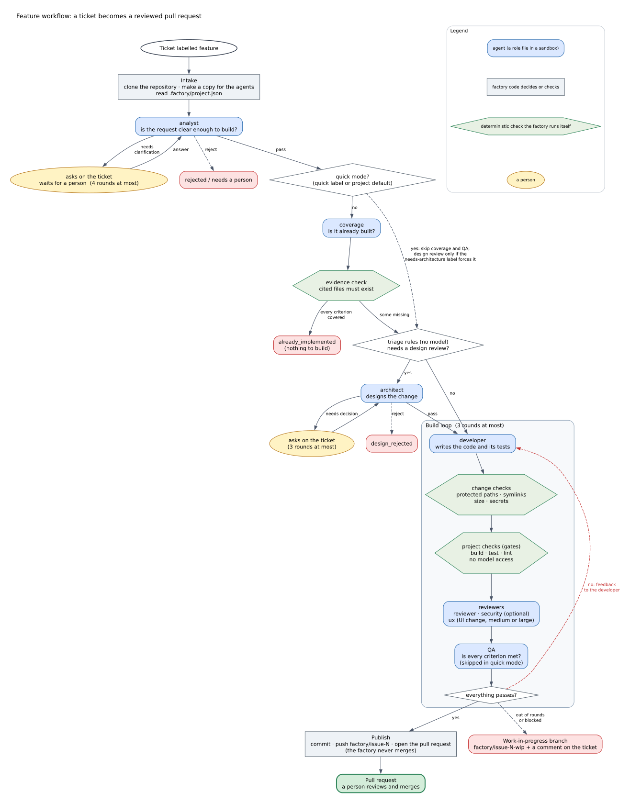
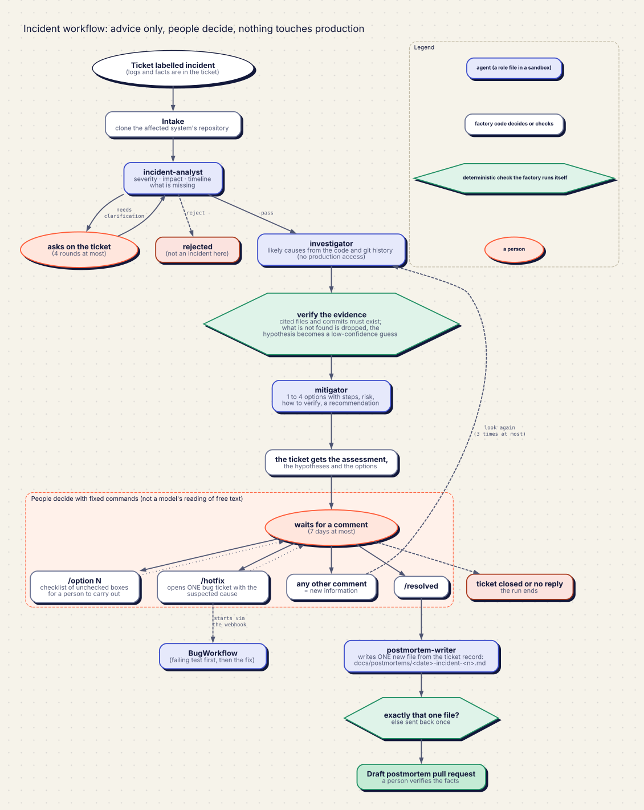

# Workflows

[Documentation index](README.md) | [Architecture](architecture.md) | [Setting up a project](project-setup.md)

The factory has three workflows, one per kind of ticket, a fourth that revises its own pull requests after a review, and a fifth that tests a finished change from the outside on request. They share the same machinery (workspace, sandbox runs, project checks,
reviewers, run record, rescue of unfinished work) and differ in which stages run first.

| You label a ticket | Workflow | What you get | Agents used |
| --- | --- | --- | --- |
| `feature` | `FeatureWorkflow` | a reviewed **pull request** | analyst, coverage, architect, developer, reviewer, security, ux, qa |
| `bug` | `BugWorkflow` | a **pull request with a fix proven by a test** that failed before and passes after | bug-analyst, reproducer, diagnostician, developer, reviewer, security |
| `incident` | `IncidentWorkflow` | an **assessment, likely causes and mitigation options** on the ticket; a **draft postmortem** pull request on request | incident-analyst, investigator, mitigator, postmortem-writer |
| a **review** or `/fix` on a factory pull request | `PullRequestRevisionWorkflow` | **one new commit** on the pull request's own branch, and a reply to each comment | pr-resolver, reviewer, security |
| **`/qa`** on a ticket or on a factory pull request | `QaWorkflow` | a **QA report** on the ticket; end-to-end API and UI tests added to the pull request when they pass | e2e-tester, ux |

If a ticket has several of these labels, `incident` wins over `feature`, which wins over `bug`. The labels `quick`, `full` and
`needs-architecture` change how a feature or bug run behaves ([Quick mode](#quick-mode)).

## Ticket routing

The router (`ForgejoEventWorkflow`, decisions in `EventRouter`) is a pure function of the event, so the same event always gets the same
answer:

| Forgejo event | What happens |
| --- | --- |
| ticket **opened**, **reopened** or **labelled**, open, with a factory label | starts that ticket's workflow. Workflow id: `<kind>-<owner>-<repo>-<number>-<hash>`; the hash of the exact owner and repository keeps similar names apart, and the same name is the ticket's workspace folder |
| the same event again for a ticket that already had a run | ignored. Comment **`/retry`** (or close and reopen the ticket) to run it again; a new run starts from the beginning and reads the whole ticket again |
| a **comment** by a person | sent to the running workflow (signal `human_reply`); see [Talking to the factory](#talking-to-the-factory) |
| a comment that is just **`/retry`**, on an open ticket | starts the ticket's workflow again from the beginning, like closing and reopening it. While a run is still active nothing starts and the person gets a notice. See [When the factory itself fails](#when-the-factory-itself-fails) |
| a comment with a line starting **`/qa`** (`/qa [full] [api|ui] [note]`), on a feature or bug ticket or on a factory pull request | starts a [QA run](#qa-run) (id `qa-<owner>-<repo>-<number>-<hash>`); a second one for the same number while one runs gets a notice |
| ticket **closed** | sent to the running workflow (`ticket_closed`); the run stops |
| comments written by the factory | ignored (they carry a hidden marker), so it never answers itself |
| a review that **requests changes**, or a comment with **`/fix`**, on a pull request | starts a [revision](#pull-request-revisions) of that pull request (id `revision-<owner>-<repo>-<pr>-<hash>`); if one is already running the person gets a notice. The factory checks that the pull request is its own |
| other pull request events and comments, tickets without a factory label | ignored |

The webhook must send **Issues**, **Issue Label** and **Issue Comment** events, and **Pull Request Review Rejected** for revisions started by a review ([Setting up a project](project-setup.md#2-add-the-webhook)). A comment on a pull request arrives as an Issue Comment event.

## Talking to the factory

Everything happens on the ticket. When a workflow needs a person it posts a comment and **waits** (up to 7 days; nothing runs while it
waits). Your reply arrives as a comment event and the workflow continues.

- Only the stages that ask questions read comments: the **analyst**, **architect**, **reproducer**, **diagnostician** and the incident
  roles. They get the replies as answers, clipped and marked as data.
- A comment that arrives **once the build has started** gets one notice per run: it cannot change what is built. Comments no stage ever
  read are reported when the run ends.
- A comment on a ticket with **no running workflow** gets a notice (not repeated while it is among the latest 10 comments). Each notice
  says what to do: update the ticket text, then close and reopen it.
- **Closing a ticket stops the run** and cleans up. Reopening it starts a new one.

Replies that need a decision are best short and concrete. If a stage keeps asking, the last round tells the model not to ask any more, so
it decides with stated assumptions.

## Feature workflow

### Stages

1. **Intake** (code). Clones the repository into a private workspace, makes a copy for the agents, creates the branch
   `factory/issue-<n>`, and reads `.factory/project.json`. Without a usable file the run stops with `needs_config` and an example
   in the comment.
2. **Analyst** (read-only). Decides whether the request is clear enough to build and lists testable acceptance criteria and complexity
   facts. `pass` continues; `needs_clarification` asks on the ticket (up to 3 rounds of questions by default; see [limits](project-setup.md#limits)); `reject` stops. An answer that does not match
   the required JSON shape gets one retry that quotes the exact problem; after that a person is asked to look.
3. **Coverage check** (read-only, then a deterministic check). Judges each criterion against the existing code as `covered`, `partial`
   or `missing`, citing up to three files. The factory checks that the files exist; a claim without an existing file is weakened
   (`covered` becomes `partial`, `partial` becomes `missing`), and a failed check can only weaken a claim. If everything is covered the
   run stops with `already_implemented`.
4. **Triage** (code, no model). Asks for a design review if any of these hold: the ticket has the `needs-architecture` label, the analyst
   estimates more than 5 files, more than one project is affected, a public API changes, the data model changes, or a new dependency is needed.
   The comment lists the reasons.
5. **Architect** (read-only, only when triage asked). Returns an approach, the components that change (safe paths and what changes), risks
   and guidance. `needs_decision` asks the ticket (up to 3 rounds, fewer if the project lowers `clarification_rounds`); `reject` stops with `design_rejected`.
6. **Build loop** (up to 3 rounds by default, `limits.build_rounds` in the project), described next.
7. **Publish** (code). Repeats the checks, copies only the verified files onto the pristine clone, commits, pushes `factory/issue-<n>` and opens
   the pull request (`Closes #<n>`). The PR text has the criteria, the design, the check results and the reviewers' notes.

### The build loop

Each round:

1. The ticket gets a comment that the round started (from round 2 it lists the review findings being fixed). The **developer** works in the **writable** workspace with a shell. It does not commit or push. When it finishes, its own summary and notes are posted; they are its claim, and the steps below decide whether it is right.
2. **Change checks** (code) read what changed: protected paths (`.factory/`, `.forgejo/`, `.github/`, `.gitea/`, CI files), symbolic links,
   file size and count (300 files, 2 MiB per file, 10 MiB total), and a secret scan. `.gitignore` decides what counts as noise.
3. **Project checks** (the gates in `.factory/project.json`) run one by one in the sandbox, **without** model access. Failures go back to the
   developer with the end of their output. Then the project's own [`rules`](project-setup.md#rules), if it has any, are checked on the lines the change adds:
   a `block` rule sends the change back to the developer, a `warn` rule is passed to the reviewers.
4. **Reviewers** (read-only, **no shell**): `reviewer`, plus `security` if the project lists it, plus `ux` when the rules below apply. They
   get the diff in the prompt, so the agents that judge the work cannot run commands while the OpenCode login is readable. Findings are
   `blocker`, `major`, `minor` or `nit`; a blocker or major finding means `needs_changes`, and the verdict is derived from the findings
   (an answer where the two disagree is refused). Minor findings and nits are listed in the pull request.
5. **QA** (read-only). Judges every remaining criterion as `met` or `not_met`; a `met` criterion must cite files and the factory checks they
   exist. Skipped in quick mode and in bug runs.
6. Anything that fails goes back to the developer as feedback and uses one of the rounds. When everything passes, the run publishes.

After a round in which a review or QA asked for changes, the next round's reviewers and QA are also given those findings (shortened to 1,500 characters) and asked to confirm that each one is really fixed, and to report any that is not as a blocking finding. They still review the whole change as usual, because a fix can bring new problems. Revisions of a pull request do not do this yet.

A review or QA answer that stays unusable after the retry stops the run (`review_failed`): **nothing is published unreviewed**.

**UX review.** The `ux` reviewer runs only for a project that declares a UI and only when the UI change is medium or large; it judges
usability, visible accessibility and consistency from the code. The decision is made by counting files and lines in the UI paths (not by
an agent). A small change gets no UX review and the pull request says why. Thresholds and patterns are in
[Project settings](project-setup.md#ui).

## Quick mode

For small, low-risk changes the full process is more than needed.

- A **`quick` label** on the ticket, or `"mode": "quick"` in `.factory/project.json` as the project's default, selects it. A **`full` label**
  always wins (over the project default, and over `quick` if both are set). Only a person chooses it: no agent can switch checks off.
- It **skips** the coverage check, the design review and QA. It **keeps** the analyst, the developer, the change and project checks, every
  configured reviewer (including `security`), the UX rule, the round caps, the run record and the human review of the pull request.
- Because nothing was checked as already covered, the developer gets every criterion. If triage would have asked for a design review, the
  ticket says so; an explicit `needs-architecture` label still forces one.
- The pull request has a "Quick mode" section naming what was skipped.

## Bug workflow

The aim is a fix **proven by a test that fails before and passes after**. The factory checks that proof itself.

| Step | Who | What the factory checks itself |
| --- | --- | --- |
| 1 | `bug-analyst` (read-only) | answer shape; asks on the ticket if the report is unclear (expected vs actual, severity) |
| 2 | `reproducer` (writes tests only) | only the test files it lists changed; no deletions; protected paths and secrets as usual |
| 3 | **RED check** | the factory runs the reproducer's `test_command` on the **unchanged code**: it must **fail**. A test that passes, or a command that cannot run (exit 126/127, timeout), goes back to the reproducer with the reason; 3 attempts at most, then `cannot_reproduce` |
| 4 | `diagnostician` (read-only) | answer shape; `too_large` stops with `needs_design` and suggests a feature ticket. Skipped in quick mode |
| 5 | `developer` | gets the failing test, the observed failure and the root cause; may not edit the test |
| 6 | **GREEN check** | the test files' SHA-256 are unchanged; the project's checks pass; **the same test command now passes** |
| 7 | reviewers | as for features. QA and the architect are not used: red then green is the proof |

The pull request is titled `Fix: <title>` and has a **Bug fix** section (severity, root cause, the test, and that it failed before and passes
after). The failing run is posted on the ticket as well. The `quick` label skips only the diagnosis.

## Incident workflow

**Advice only. Nothing touches production.** The ticket is the only source of facts. It is written by a person, or filed by something else
(a monitoring collector, once there is a production system to watch); the agents have no logs, metrics or credentials.

| Step | Who | What the factory checks itself |
| --- | --- | --- |
| 1. Assess | `incident-analyst` (read-only) | answer shape. Severity `low`/`medium`/`high`/`critical`, impact, timeline, what is missing; asks on the ticket if the report is unclear |
| 2. Investigate | `investigator` (read-only, may use `git log/show/blame/diff` on the full history) | every file and commit it cites must exist. What cannot be found is dropped, and a hypothesis left with nothing to point at is shown as a **guess (low confidence)** |
| 3. Options | `mitigator` (read-only) | 1 to 4 options (rollback, feature flag, config change, scale, restart, hotfix, monitor) with steps, risk, how to verify, reversible or not, and a recommendation |
| 4. People decide | fixed **slash commands**, not a model reading free text | see below |

Write these on their own line in a comment on the incident ticket:

| Command | What it does |
| --- | --- |
| `/option N` | posts the checklist for option N (unchecked boxes). A person carries it out; the factory has no access to production |
| `/hotfix` | opens **one** `bug` ticket with the suspected cause. It needs a `bug` label in the repository and starts the [bug workflow](#bug-workflow) through the webhook |
| `/resolved` | the incident is over: `postmortem-writer` drafts `docs/postmortems/<date>-incident-<n>.md` from the ticket's record only (comments, assessment, hypotheses, options, timeline), marked "unknown" where the record is silent. The factory accepts exactly that one new file and opens a pull request |
| any other comment | **new information**: the investigator and mitigator look again (3 times at most; then the ticket is told to use a command or close it) |

Closing the ticket ends the run; so does 7 days without a reply. Anyone who can comment on the ticket can use the commands.

## Pull request revisions

After the factory opens a pull request, a person reviews it. If they want changes, they do not have to make them by hand:

- **Submit a review that requests changes**, with an overall text and/or comments on lines, or
- **comment `/fix`** on the pull request. Text after the command is an extra instruction (`/fix rename the helper and add a test`). `/fix` alone acts on
  **every review still waiting** (request-changes or comment reviews by people, including each "Add single comment", since Forgejo makes every single comment its own review).
  Dismissed reviews, conversations a person marked resolved, and reviews older than the factory's last reply are skipped.

The factory revises **only its own pull requests**: the branch must be one it created (`factory/issue-<n>`), the pull request must be authored by the bot, from the same repository, and still open.
Anything else is left alone without a word. At most **three revisions per pull request** by default (`limits.revisions_per_pull_request`), **one at a time**. A review or `/fix` that arrives while one is running is not lost: the factory says it is queued, and when the running revision has pushed or replied it starts a follow-up that reads what came in meanwhile.

| Step | Who | What the factory checks itself |
| --- | --- | --- |
| 1. Read | the factory | the pull request, every review still waiting and its line comments **with the code each was written on**, from Forgejo. Every comment is numbered |
| 2. Resolve | `pr-resolver` (writable, shell, package access) in a checkout of the **pull request's own branch** | **every numbered comment is answered exactly once**, as `fixed`, `answered`, `declined` (with a reason) or `needs_clarification` (with the question); and a `fixed` answer must come with changed files |
| 3. Checks | the factory | the same change checks and project checks as for a feature; failures go back with the output (`limits.build_rounds`, 3 by default) |
| 4. Review | `reviewer`, `security` if configured, `ux` by its rule | judged on the revision's diff. A revision that changes **3 or more files** is also checked by QA against the acceptance criteria in the pull request body |
| 5. Push | the factory | **one new commit** pushed onto the same branch as a normal push, **never forced**. If a person pushed to the branch meanwhile, the commit is put on top of theirs once (and the reply says so); if that conflicts, nothing is pushed |
| 6. Reply | the factory | a comment with the new commit, a table of what was done for each comment, and the check results. The reviewers are asked to review again. A person reviews again; the factory never merges |

The factory cannot mark conversations resolved or reply inside a comment's conversation (Forgejo's API has neither), so its answers are only in the summary comment's table; the reviewer resolves conversations. If every comment was answered or declined and nothing needed to change, the factory pushes nothing and replies with the answers. If the rounds run out or the resolver is blocked, nothing is pushed to the pull request and the work is saved
to a `-wip` branch, as for a feature. Statuses: `revision_pushed`, `revision_replied`, `revision_limit`, `nothing_to_do`, `ignored` (and the shared `build_failed`, `build_blocked`, `publish_failed`).
With `"record": true` the revision's [run record](#the-run-record) is committed with it under `.factory/runs/pr-<number>-<run>/`. The number of revisions is counted from the hidden marker in the factory's replies.

## QA run

A deeper test of a change that is already finished, started by a person with a comment on the ticket or on the factory's pull request. The command is a line starting with `/qa`:

| You write | What happens |
| --- | --- |
| `/qa` | the tester covers **this pull request's change**: each acceptance criterion, and the edges around it. It is told not to spend effort elsewhere |
| `/qa full` | the **whole application and the change**: the criteria first, then the other main flows and endpoints, so the tests also work as a regression suite |
| `/qa api`, `/qa ui`, `/qa full ui` | run only that suite (the words can come in either order, `full` and the suite first) |
| `/qa <your note>` | the note, and any lines below it, are given to the tester to take into account, for example `/qa focus on the 404 cases` or `/qa full api check what happens with an empty city id`. Up to 1,500 characters; it is data from a person, not instructions that change the tester's role |

The report names the scope and repeats your note.
  The project must have [`verify`](project-setup.md#end-to-end-checks-verify) settings; without them the ticket
gets an answer that says how to add them.

| Step | Who | What is checked |
| --- | --- | --- |
| 1 | code | the pull request exists, is open, is the factory's own (branch `factory/issue-<n>`, author the bot, same repository) and the project has the suite asked for |
| 2 | `e2e-tester` (reads, edits, runs commands, like the developer) | starts the application as `verify.start` says, tries it from the outside, and writes API and/or UI tests under `verify.tests` (the same sandbox settings as the developer: model and package registries, nothing else) |
| 3 | code | only files under the tests folder changed; no deletions, no secrets, no protected files. Anything else goes back to the tester |
| 4 | **the factory** | runs each suite itself in a fresh sandbox **without the model login**: starts the application, waits for `verify.ready`, runs the suite, stops the application. Pass and fail are facts; the tester's word is not used |
| 5 | `e2e-tester` again, up to 3 attempts | after a failing run it sees the output and says for each failing test whether it is an `application_bug` (keep the test) or a `test_problem` (fix it). If all it names are application bugs, the loop stops |
| 6 | `ux` | when a `ui` suite ran, reads the page text and accessibility snapshots the tests left in `<tests>/evidence/` (removed before anything is pushed) and the repository's UI code |
| 7 | code | if **every** suite passed, the tests are pushed to the pull request as **one commit**; otherwise they are saved to a work-in-progress branch and **not** added, so a wrong test never reaches the pull request |
| 8 | code | posts the report on the ticket |

The report lists each suite's result, the scenarios, where the tests went, the UX review, the numbered **findings to fix**, and the tokens the agents of the run used. A finding is
the tester's own observation or a failing test; a failing test is a fact, but it can still be a wrong test, so a person decides.

Comment **`/fix qa`** on the pull request to have the [revision flow](#pull-request-revisions) address the findings of the latest QA report (each finding is one comment to act on).
The tests folder is a protected path in every other run, so the developer cannot weaken the tests that judge its work; only the QA run writes there.

If the application does not start, the report says so as a blocking finding and the other suites are not tried. A sandbox that fails for the factory's own reasons ends the run with
`infrastructure_failed` ([When the factory itself fails](#when-the-factory-itself-fails)), and `/retry` is not needed: comment `/qa` again.

**Run record.** With `"record": true` the tester's and the UX reviewer's steps (what they were told and answered, with their tokens) and each suite's output are recorded, and committed under `.factory/runs/qa-<number>-<run>/` together with the tests commit (or the `-wip` branch). A QA run that ends without either (blocked, not configured, the app never started) commits no record.

**Tokens.** Every workflow now keeps the total token use of its agents in the workflow result (`usage`, visible in Temporal whatever the project's `record` setting); the QA report also
shows it, and with `record: true` the per-step numbers are in the run record.

## When the factory itself fails

Some failures say nothing about the ticket or the agent's work: a sandbox stopped reporting progress (heartbeat timeout), the launcher did not pick the run up, or Docker refused to start a container. The controller tells these apart from the rest (`InfrastructureFailure`): a timeout of a sandbox activity, or a `Docker` error from the launcher. A rejected request (unknown image, bad command) or a missing login is not one of them, because running it again changes nothing.

For these the ticket comment says it is a problem with the factory itself, not with the ticket, and the run ends with the status `infrastructure_failed`. Code written so far is saved to the work-in-progress branch like for any other stop. A check that cannot run for this reason also ends the run at once; it is not sent to the developer as feedback, which would only cost a build round and tokens.

Comment **`/retry`** on the ticket to run it again. `/retry` starts the ticket's workflow from the beginning, exactly like closing and reopening it (it reads the current ticket text, so edit the ticket first if needed). It needs the ticket to be open and the earlier run to have finished; while a run is still active the person gets one notice instead. It does not resume from the last good stage.

## When a run stops: the work-in-progress branch

A run that stops without a pull request would otherwise lose everything the developer wrote, because the checkout is deleted when the
workflow ends. So the controller saves the work first.

- **When:** after `build_failed`, `build_blocked`, `review_failed`, `publish_failed`, a lost login (`blocked`) and any unexpected `error`. Not when a person closed
  the ticket, and not for runs that stopped before any code was written.
- **Where:** a branch `factory/issue-<n>-wip` (or `-wip-2`, ... if one exists; an earlier branch is never overwritten), with one commit
  `WIP: <title> (#<n>), not finished`. No pull request is opened.
- **What:** the same trusted path as a publish, but the checks do not have to pass. Only a file with a problem of its own is left out and listed in the
  comment: a protected file, a symbolic link, a file over 2 MiB, one the secret scan flags. If more than 300 files changed (usually build output) or the
  total is too big, nothing is saved and the comment says why. Credentials are never pushed.
- **The comment** says why the run stopped, which branch holds the work, what was left out, and links to the run in Temporal (kept for
  `TEMPORAL_RETENTION`, 7 days by default).

Publishing and saving can be repeated safely: the pristine clone is reset before every inspection, a branch that already holds exactly the same content is reused, and a
re-run on a ticket whose branch exists gets the next free name instead of a rejected push.

## The run record

With `"record": true` in `.factory/project.json`, the pull request (and a work-in-progress branch) also contains
`.factory/runs/issue-<n>-<8 characters of the run id>/`:

| File | Content |
| --- | --- |
| `README.md` | the ticket, how the run ended, one line per step with a link, and a usage table by role |
| `index.json` | the same list for tools: step, kind, attempt, outcome, seconds, exit code, file, model, tokens, cost |
| `usage.json` | tokens and cost: the total, per role and per step |
| `001-analyst.md`, `002-...md` | one file per agent run or project check, in order: the **prompt**, the **answer**, the outcome, timing, model and tokens |

Safe to commit by design: the **controller writes it** (agents cannot), lines that look like credentials and the factory's own token are replaced
before anything is written, large prompts and outputs are cut and say so, and each run has its own folder. An answer the factory rejected is kept
as its own step. Usage is exactly what OpenCode reports (input, output, reasoning and cache tokens, and its `cost`, which is 0 with a ChatGPT login).
OpenCode does not say which model answered, so the model shown is the one configured for the role. Prompts contain ticket text, so a record is as
visible as the repository.

## Reference

### Limits and timeouts

| What | Value |
| --- | --- |
| Questions to people per stage | the analysts (feature, bug, incident): 4 runs, which is 3 rounds of questions; architect, diagnostician, investigator and mitigator: 3; reproducer: 2 per attempt. The last round forbids questions |
| Build rounds | 3 |
| Retry of an unusable agent answer | 1 (the retry quotes the exact problem) |
| Reproduction attempts (bug) | 3, with 2 question rounds each |
| Revisions per pull request | 3, one at a time; 3 build rounds each; at most 30 comments per revision |
| Incident looks at new information | 3 |
| Wait for a person | 7 days |
| One agent run | 15 minutes; the developer 30 minutes; capped by `SANDBOX_MAX_RUN_SECONDS` (30 minutes) |
| A project check (gate) | its `timeout_seconds` (default 600, at most 1800) |
| Changed files / one file / total | 300 / 2 MiB / 10 MiB |
| `.factory/project.json` | 16 KB |
| Agents running at once | 2 (`SANDBOX_MAX_CONCURRENT`) |

### Result statuses

The status is the workflow's result, shown in Temporal. Most have a comment on the ticket.

| Status | Meaning |
| --- | --- |
| `pr_opened` | feature or bug: the pull request is open |
| `postmortem_opened` | incident: the draft postmortem pull request is open |
| `no_changes` | the work produced nothing to publish |
| `already_implemented` | the coverage check found every criterion already met |
| `rejected`, `design_rejected` | the analyst (or bug/incident analyst) or the architect said it cannot or should not be done as asked |
| `needs_design` | bug: the cause is larger than a bug fix; open a feature ticket |
| `needs_human` | the rounds of questions were used up; a person has to decide |
| `revision_pushed`, `revision_replied` | revision: the new commit is on the pull request, or the comments were answered with nothing to change |
| `revision_limit` | revision: the project's limit of revisions (3 by default) was already reached on this pull request |
| `nothing_to_do` | revision: a `/fix` with no text and no review to act on |
| `ignored` | revision: not the factory's pull request (no comment), or the pull request is closed or merged (with a note) |
| `cannot_reproduce` | bug: no test that fails because of the bug was produced in 3 attempts |
| `needs_config` | the repository has no usable `.factory/project.json` |
| `setup_failed` | the workspace could not be prepared |
| `qa_reported` | qa: the report is on the ticket (the tests that passed are on the pull request, or saved to a `-wip` branch) |
| `qa_blocked` | qa: the tester could not write tests it could stand behind (the reason is on the ticket) |
| `qa_failed` | qa: the tester's answer stayed unusable after the retry |
| `qa_not_configured` | qa: the project has no `verify` settings, or not the suite that was asked for |
| `qa_no_pull_request` | qa: there is no open pull request of the factory for this ticket |
| `infrastructure_failed` | a part of the factory's own machinery failed (a sandbox stopped reporting progress, the launcher or Docker was unavailable); the ticket says so and that `/retry` runs it again (saved if code existed) |
| `image_failed` | the repository's own `.factory/Dockerfile` could not be read or built (see [a project's own image](project-setup.md#a-projects-own-image)) |
| `analysis_failed`, `assessment_failed`, `coverage_failed`, `design_failed`, `diagnosis_failed`, `reproduction_failed`, `investigation_failed`, `mitigation_failed`, `postmortem_failed` | an agent's answer stayed unusable after the retry (or, for the postmortem, the file was wrong twice); the reason is on the ticket |
| `build_failed` | the build rounds (3 by default) did not get through the checks and review (work saved to a `-wip` branch) |
| `build_blocked` | the developer said it cannot continue (for example the ticket needs a protected file changed) (saved) |
| `review_failed` | a review or QA answer stayed unusable; nothing was published (saved) |
| `publish_failed` | publishing or opening the pull request failed (saved, or the branch is named in the comment) |
| `blocked` | OpenCode is not signed in ([login guide](opencode-login.md)) (saved if code existed) |
| `error` | an unexpected error; the ticket says so (saved if code existed) |
| `timed_out` | nobody answered for 7 days |
| `closed` | a person closed the ticket |

### Labels

| Label | Effect |
| --- | --- |
| `feature`, `bug`, `incident` | choose the workflow ([routing](#ticket-routing)) |
| `quick`, `full` | [quick mode](#quick-mode) on or off for this ticket |
| `needs-architecture` | forces a design review, even in quick mode |

### Where the code is

Decisions are in `Workflows/` (`EventRouter`, `FeatureWorkflow`, `BugWorkflow`, `IncidentWorkflow` on a shared `FactoryWorkflowBase`), the
parsers and prompts of each role in `Agents/<role>/`, and git handling in `Workspace/`. See the
[controller guide](../services/controller/README.md#code-layout). The scenario tests run the real workflows on a Temporal dev server with scripted agents.
